# Jarkom Modul 3: Curtain Protocol, Shibuya Incident

**Kelompok K-68 (Group C), Praktikum Komunikasi Data dan Jaringan Komputer 2026**

| | |
|---|---|
| Prefix IP | `192.245.0.0/16`, seluruh subnet memakai `/24` |
| Domain | `jujutsu.K68.com` |
| Domain search DHCP | `K68.com` |
| Database | `db_shibuya_K68` |
| Controller GNS3 | Group C, `http://10.4.89.250/` (wajib jaringan atau VPN ITS) |

## Anggota dan Pembagian

| Nama | NRP | Soal |
|---|---|---|
| Ryan Adya Purwanto | 5027231046 | 1 sampai 13 |
| Made Gde Krisna Wangsa | | 14 sampai 20 |

Laporan ini mencakup **soal 1 sampai 13**.

## Daftar Isi

- [Topologi](#topologi)
- [Pembagian IP](#pembagian-ip)
- [Catatan Teknis Penting](#catatan-teknis-penting)
- [Soal 1: Konfigurasi Router, Forwarding, dan NAT](#soal-1-konfigurasi-router-forwarding-dan-nat)
- [Soal 2: DHCP Server pada tengen](#soal-2-dhcp-server-pada-tengen)
- [Soal 3: DHCP Relay pada jichi](#soal-3-dhcp-relay-pada-jichi)
- [Soal 4: Dua Pool DHCP dengan DHCP Class](#soal-4-dua-pool-dhcp-dengan-dhcp-class)
- [Soal 5: Short Lease, Long Lease, dan DHCP Options](#soal-5-short-lease-long-lease-dan-dhcp-options)
- [Soal 6: Fixed Address untuk kugisaki](#soal-6-fixed-address-untuk-kugisaki)
- [Soal 7: Verifikasi Konfigurasi Seluruh Client](#soal-7-verifikasi-konfigurasi-seluruh-client)
- [Soal 8: Packet Capture DORA dan giaddr](#soal-8-packet-capture-dora-dan-giaddr)
- [Soal 9: Simulasi Gangguan Relay](#soal-9-simulasi-gangguan-relay)
- [Soal 10: Autostart dan Uji Restart Node](#soal-10-autostart-dan-uji-restart-node)
- [Soal 11: DNS Master dan Slave](#soal-11-dns-master-dan-slave)
- [Soal 12: A Record, CNAME, Reverse Zone, dan Forwarder](#soal-12-a-record-cname-reverse-zone-dan-forwarder)
- [Soal 13: Replikasi Database MariaDB](#soal-13-replikasi-database-mariadb)
- [Struktur Repository](#struktur-repository)

---

## Topologi

Infrastruktur terdiri atas 21 node, 10 switch, dan 1 node NAT. Router `jichi` memakai lima interface, yaitu `eth0` menuju NAT dan `eth1` sampai `eth4` sebagai gateway Network 1 sampai Network 4.

```
NAT1 ----------------- jichi eth0

jichi eth1 --- Switch1 ................... utahime, shoko, gojo        [Net 1, DMZ]

jichi eth2 --- Switch2 --+-- Switch3 ----- itadori, fushiguro          [Net 2, Divisi A]
                         +-- Switch4 ----- zenin, okkotsu

jichi eth3 --- Switch5 --+-- Switch6 ----- ino, kusakabe               [Net 3, Divisi B]
                         +-- Switch7 ----- miwa, kugisaki

jichi eth4 --- Switch8 --+-- Switch9 ----- geto, maki, panda,          [Net 4, Data Center]
                         |                 nanami, todo, kirara
                         +-- Switch10 ---- tengen, yaga, inumaki
```

Switch anak (Switch3, Switch4, Switch6, Switch7, Switch9, Switch10) tidak tersambung langsung ke `jichi` melainkan ke switch induknya. Karena switch bekerja pada layer 2 dan tidak memisahkan jaringan, setiap rangkaian switch tersebut tetap membentuk **satu broadcast domain**, sehingga tetap satu subnet. Itulah sebabnya 10 switch hanya menghasilkan 4 subnet.

### Image Docker

Pembagian image mengikuti ketentuan soal.

| Image | Node |
|---|---|
| `ardhptr21/debinet:latest` | jichi, tengen, utahime, shoko, gojo, geto, maki, panda, nanami, todo, kirara, yaga, inumaki |
| `ardhptr21/alpinet:latest` | itadori, fushiguro, zenin, okkotsu, ino, kusakabe, miwa, kugisaki |

Perbedaan yang berpengaruh pada pengerjaan:

| | debinet (Debian) | alpinet (Alpine) |
|---|---|---|
| Manajer paket | `apt-get install` | `apk add` |
| DHCP client | `dhclient` | `udhcpc` |
| Sintaks ping | opsi bebas posisinya | opsi **wajib sebelum** target |

## Pembagian IP

| Interface jichi | Switch induk | Subnet | Isi |
|---|---|---|---|
| eth0 | NAT1 | DHCP dari NAT | WAN |
| eth1 | Switch1 | 192.245.1.0/24 | DMZ |
| eth2 | Switch2 | 192.245.2.0/24 | Divisi A |
| eth3 | Switch5 | 192.245.3.0/24 | Divisi B |
| eth4 | Switch8 | 192.245.4.0/24 | Data Center |

### Host dengan IP statis

| Node | IP | Gateway | Peran |
|---|---|---|---|
| jichi eth1 | 192.245.1.1 | | gateway Net 1 |
| jichi eth2 | 192.245.2.1 | | gateway Net 2 |
| jichi eth3 | 192.245.3.1 | | gateway Net 3 |
| jichi eth4 | 192.245.4.1 | | gateway Net 4 |
| utahime | 192.245.1.2 | 192.245.1.1 | DNS Master |
| shoko | 192.245.1.3 | 192.245.1.1 | DNS Slave |
| gojo | 192.245.1.4 | 192.245.1.1 | Public Reverse Proxy |
| geto | 192.245.4.2 | 192.245.4.1 | Internal Load Balancer |
| maki | 192.245.4.3 | 192.245.4.1 | Worker frontend |
| panda | 192.245.4.4 | 192.245.4.1 | Worker frontend |
| nanami | 192.245.4.5 | 192.245.4.1 | Worker API utama |
| todo | 192.245.4.6 | 192.245.4.1 | Worker API utama |
| kirara | 192.245.4.7 | 192.245.4.1 | Worker API cadangan |
| yaga | 192.245.4.8 | 192.245.4.1 | Database Master |
| inumaki | 192.245.4.9 | 192.245.4.1 | Database Slave |
| tengen | 192.245.4.10 | 192.245.4.1 | DHCP Server |

### Client dengan IP dari DHCP

Delapan client tidak diberi IP statis sama sekali, karena pemberian alamat lewat DHCP justru merupakan isi soal 2 sampai 7.

| Client | Network | MAC Address | Kebijakan |
|---|---|---|---|
| itadori | 2 | `02:42:17:51:a0:00` | Pool 1 |
| fushiguro | 2 | `02:42:1f:87:4e:00` | Pool 1 |
| zenin | 2 | `02:42:e8:81:d1:00` | Pool 2 |
| okkotsu | 2 | `02:42:21:d8:76:00` | Pool 2 |
| ino | 3 | `02:42:63:d1:c3:00` | Short lease |
| kusakabe | 3 | `02:42:07:5d:fd:00` | Short lease |
| miwa | 3 | `02:42:7a:74:c4:00` | Long lease |
| kugisaki | 3 | `02:42:60:61:67:00` | Fixed address |

## Catatan Teknis Penting

Tiga kendala lingkungan berikut menentukan cara seluruh konfigurasi ditulis.

### 1. Hanya `/root` dan `/etc/network/interfaces` yang bertahan saat node restart

Node Docker kembali ke kondisi image setiap kali dinyalakan ulang. Yang hilang bukan hanya berkas konfigurasi di `/etc`, melainkan juga **paket yang sudah di-install** dan isi `/var/lib`. Akibatnya:

- `/etc/dhcp`, `/etc/bind`, `/etc/mysql`, `/etc/resolv.conf` hilang
- `isc-dhcp-server`, `bind9`, `mariadb-server` perlu di-install ulang
- `/var/lib/dhcp/dhcpd.leases` dan `/var/lib/mysql` ikut kosong

Karena itu seluruh konfigurasi tidak diketik langsung ke lokasi aslinya, melainkan ditulis oleh **script yang disimpan di `/root`**, dan setiap script memuat perintah `apt-get install` di dalamnya. Script tersebut lalu dipanggil otomatis dari `/etc/network/interfaces` melalui baris `up`.

### 2. Editor network configuration GNS3 membuang baris yang mengandung karakter `>`

Perintah pengalihan output tidak boleh ditulis langsung di `interfaces`. Solusinya, perintah tersebut disembunyikan di dalam berkas script, dan `interfaces` hanya memanggilnya.

```
	up bash /root/dns.sh
```

### 3. Jumlah adapter dinaikkan per node, bukan lewat template global

`jichi` memerlukan lima interface. Karena praktikum berjalan di remote controller yang dipakai bersama seluruh kelompok, mengubah template global akan berdampak ke kelompok lain. Perubahan dilakukan melalui klik kanan node, lalu Configure, lalu tab Network, lalu Adapters diisi 8, dan hanya pada `jichi`.

---

## Soal 1: Konfigurasi Router, Forwarding, dan NAT

### Soal

> Ketika Curtain menutup Shibuya, jalur komunikasi antar zona Jujutsu High terputus. Pulihkan konektivitas dasar dengan mengonfigurasi jichi: eth0 memperoleh WAN dari NAT, sedangkan eth1 sampai eth4 menjadi gateway Network 1 sampai 4 sesuai tabel pemetaan. Aktifkan IPv4 forwarding dan source NAT, lalu tetapkan IP statis host infrastruktur sesuai tabel spesifikasi. Buktikan konektivitas setiap host ke gateway dan akses eksternal dari host yang relevan.

### Inti Soal

Tiga pekerjaan sekaligus:

1. Memberi alamat pada kelima interface `jichi`, dengan `eth0` memakai DHCP dari NAT dan `eth1` sampai `eth4` statis sebagai gateway tiap network.
2. Menyalakan IPv4 forwarding dan source NAT di `jichi`, supaya node internal dapat menjangkau internet.
3. Memberi IP statis pada 12 host infrastruktur, lalu membuktikan konektivitas.

Delapan client sengaja dibiarkan tanpa alamat, karena itu bagian soal 2 sampai 7.

### Langkah Pengerjaan

**Langkah 1.** Naikkan jumlah adapter `jichi` menjadi 8. Node harus dalam keadaan mati, lalu klik kanan node, Configure, tab Network, isi Adapters dengan 8.

**Langkah 2.** Pasang kabel. Urutan port di sisi `jichi` harus berurutan dari `eth0`, karena nama interface di dalam node ditentukan oleh nomor slot adapter di GNS3. Kabel yang tertukar menghasilkan konfigurasi yang benar secara sintaks tetapi terpasang di jaringan yang salah, dan kesalahan seperti itu tidak terlihat dari berkas konfigurasi.

**Langkah 3.** Isi `/etc/network/interfaces` pada `jichi` dan 12 host infrastruktur. Node harus mati, lalu klik kanan node dan pilih Edit network configuration.

**Langkah 4.** Nyalakan seluruh node, lalu buat berkas script di `/root` pada masing-masing node dan jalankan sekali secara manual.

### Konfigurasi

**jichi**, berkas `/etc/network/interfaces`

```
auto eth0
iface eth0 inet dhcp
	up bash /root/nat.sh

auto eth1
iface eth1 inet static
	address 192.245.1.1
	netmask 255.255.255.0

auto eth2
iface eth2 inet static
	address 192.245.2.1
	netmask 255.255.255.0

auto eth3
iface eth3 inet static
	address 192.245.3.1
	netmask 255.255.255.0

auto eth4
iface eth4 inet static
	address 192.245.4.1
	netmask 255.255.255.0
```

Interface `eth1` sampai `eth4` sengaja **tidak diberi baris `gateway`**. Default gateway hanya boleh ada satu per host, dan bagi router jalur keluarnya adalah `eth0` yang sudah memperoleh default route otomatis dari DHCP NAT. Menambahkan gateway di interface LAN akan membuat router mengarahkan trafik keluar ke jaringan internalnya sendiri.

**jichi**, berkas `/root/nat.sh`

```bash
cat > /root/nat.sh <<'EOF'
#!/bin/bash
sysctl -w net.ipv4.ip_forward=1

iptables -t nat -C POSTROUTING -o eth0 -j MASQUERADE 2>/dev/null || \
    iptables -t nat -A POSTROUTING -o eth0 -j MASQUERADE
EOF
chmod +x /root/nat.sh
bash /root/nat.sh
```

Pola `iptables -C ... || iptables -A ...` dipakai agar aturan hanya ditambahkan apabila belum ada. Tanpa pola ini, aturan MASQUERADE bertambah satu setiap kali node restart.

`MASQUERADE` dipilih daripada `SNAT` karena alamat `eth0` diperoleh lewat DHCP dan bisa berubah. `MASQUERADE` membaca alamat interface secara dinamis saat paket lewat, sedangkan `SNAT` memerlukan alamat yang ditulis tetap.

**12 host infrastruktur**, berkas `/etc/network/interfaces`

Pola sama untuk semuanya, hanya `address` dan `gateway` yang berbeda. Contoh pada `utahime`:

```
auto eth0
iface eth0 inet static
	address 192.245.1.2
	netmask 255.255.255.0
	gateway 192.245.1.1
	up bash /root/dns.sh
```

Daftar lengkap alamat ada pada tabel di bagian [Pembagian IP](#pembagian-ip). Berkas untuk seluruh node tersimpan di `config/interfaces/`.

**12 host infrastruktur**, berkas `/root/dns.sh`

```bash
cat > /root/dns.sh <<'EOF'
echo "nameserver 192.168.122.1" > /etc/resolv.conf
EOF
chmod +x /root/dns.sh
bash /root/dns.sh
```

Resolver awal ini wajib dipasang sejak sekarang, karena tanpa DNS perintah `apt-get` tidak dapat menerjemahkan `deb.debian.org`, sehingga seluruh instalasi paket pada soal berikutnya akan gagal.

### Pengujian

```bash
# di jichi
ip a
iptables -t nat -L POSTROUTING -n -v

# di utahime, Network 1
ping 192.245.1.1 -c 3
ping 8.8.8.8 -c 3

# di tengen, Network 4
ping 192.245.4.1 -c 3
ping 192.245.1.2 -c 3
```

**Hasil pada jichi**

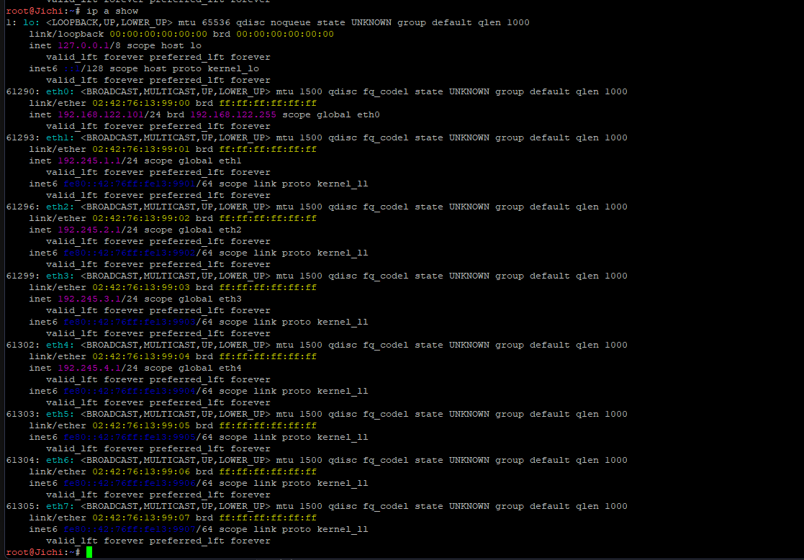

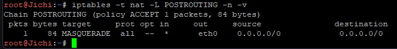

**Hasil pada utahime dan tengen**

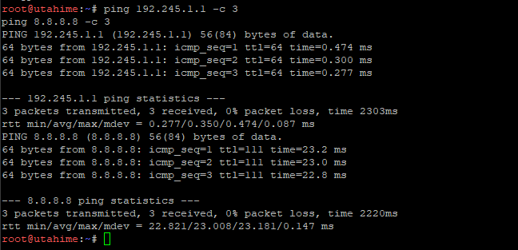

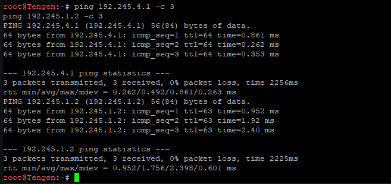

| Uji | Hasil |
|---|---|
| `ip a` di jichi | eth0 memperoleh `192.168.122.101/24`, eth1 sampai eth4 memegang `.1.1`, `.2.1`, `.3.1`, `.4.1` |
| `iptables -t nat -L POSTROUTING` | aturan `MASQUERADE` dengan `out: eth0` terpasang |
| utahime ke gateway | berhasil, `ttl=64` |
| utahime ke `8.8.8.8` | berhasil, `ttl=111`, membuktikan NAT bekerja |
| tengen ke gateway | berhasil, `ttl=64` |
| tengen ke utahime | berhasil, `ttl=63` |

Nilai TTL berguna sebagai penghitung hop. TTL awal Linux adalah 64, dan berkurang satu setiap melewati router. Nilai `ttl=64` berarti komunikasi sesubnet yang tidak melewati router sama sekali, sedangkan `ttl=63` berarti melewati tepat satu router, yaitu `jichi`.

### Catatan

Interface `eth5` sampai `eth7` muncul tanpa alamat pada `jichi`. Itu adapter cadangan hasil pengaturan Adapters bernilai 8, sementara yang dipakai hanya `eth0` sampai `eth4`.

---

## Soal 2: DHCP Server pada tengen

### Soal

> Tengen, penjaga pusat distribusi di Data Center, harus mengambil alih pengalokasian alamat bagi wilayah yang membutuhkan konfigurasi dinamis. Konfigurasikan isc-dhcp-server pada 192.245.4.10. Deklarasikan Network 4 (192.245.4.0/24) sebagai subnet lokal tanpa pool dinamis, lalu siapkan scope DHCP untuk Network 2 (192.245.2.0/24) dan Network 3 (192.245.3.0/24). Validasi konfigurasi dan pastikan service aktif tanpa error "No subnet declaration".

### Inti Soal

Memasang `isc-dhcp-server` pada `tengen`, lalu menulis tiga deklarasi subnet:

1. Network 4 sebagai subnet lokal **tanpa range**, karena di situlah `tengen` berada.
2. Network 2 dan Network 3 sebagai scope yang benar-benar membagikan alamat.

Blok Network 4 yang kosong itu bukan kelalaian, melainkan justru kunci soal ini. Daemon `dhcpd` menolak start apabila interface yang didengarkan tidak memiliki deklarasi subnet yang cocok, dan penolakan itu muncul persis sebagai pesan `No subnet declaration for eth0` yang soal minta untuk dihindari.

### Langkah Pengerjaan

**Langkah 1.** Install `isc-dhcp-server` pada `tengen`.

**Langkah 2.** Tentukan interface yang didengarkan lewat `/etc/default/isc-dhcp-server`.

**Langkah 3.** Tulis `/etc/dhcp/dhcpd.conf` berisi tiga deklarasi subnet.

**Langkah 4.** Siapkan berkas lease kosong, validasi konfigurasi, lalu jalankan service.

Seluruhnya dibungkus dalam satu script di `/root/setup-dhcp.sh`, karena `/etc/dhcp` dan `/etc/default` termasuk yang hilang saat node restart.

### Konfigurasi

**tengen**, berkas `/root/setup-dhcp.sh`

```bash
cat > /root/setup-dhcp.sh <<'SCRIPT'
#!/bin/bash
export DEBIAN_FRONTEND=noninteractive
apt-get update -y
apt-get install -y isc-dhcp-server

cat > /etc/default/isc-dhcp-server <<'EOF'
INTERFACESv4="eth0"
INTERFACESv6=""
EOF

cat > /etc/dhcp/dhcpd.conf <<'EOF'
authoritative;

default-lease-time 600;
max-lease-time 7200;

option domain-name-servers 192.245.1.2, 192.245.1.3;

subnet 192.245.4.0 netmask 255.255.255.0 {
}

subnet 192.245.2.0 netmask 255.255.255.0 {
    range 192.245.2.10 192.245.2.35;
    option routers 192.245.2.1;
    option subnet-mask 255.255.255.0;
    option broadcast-address 192.245.2.255;
}

subnet 192.245.3.0 netmask 255.255.255.0 {
    range 192.245.3.10 192.245.3.89;
    option routers 192.245.3.1;
    option subnet-mask 255.255.255.0;
    option broadcast-address 192.245.3.255;
}
EOF

mkdir -p /var/lib/dhcp
touch /var/lib/dhcp/dhcpd.leases

dhcpd -t -cf /etc/dhcp/dhcpd.conf
service isc-dhcp-server restart
SCRIPT
chmod +x /root/setup-dhcp.sh
bash /root/setup-dhcp.sh
```

### Pengujian

```bash
dhcpd -t -cf /etc/dhcp/dhcpd.conf
service isc-dhcp-server status
```

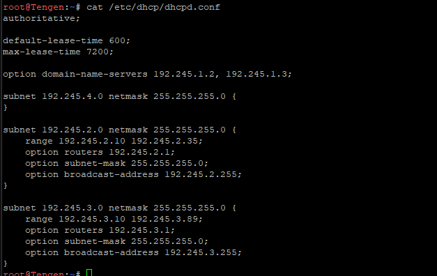

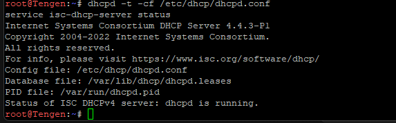

| Uji | Hasil |
|---|---|
| `dhcpd -t -cf` | selesai tanpa error, menampilkan Config file, Database file, dan PID file |
| `service isc-dhcp-server status` | `Status of ISC DHCPv4 server: dhcpd is running` |
| Pesan `No subnet declaration for eth0` | tidak muncul |

Pada tahap ini client belum dapat memperoleh alamat, karena permintaan DHCP berupa broadcast yang tidak dapat menyeberangi router. Penyelesaiannya ada pada soal 3.

---

## Soal 3: DHCP Relay pada jichi

### Soal

> Permintaan alamat dari Divisi A dan Divisi B tidak dapat menyeberangi subnet secara langsung. Konfigurasikan jichi sebagai DHCP Relay menuju tengen (192.245.4.10), menggunakan eth2 untuk Network 2 dan eth3 untuk Network 3. Buktikan bahwa client dari kedua subnet berhasil memperoleh lease melalui relay.

### Inti Soal

Permintaan DHCP dikirim sebagai broadcast, dan broadcast tidak diteruskan oleh router. Akibatnya paket dari client Network 2 dan Network 3 berhenti di `jichi` dan tidak pernah sampai ke `tengen` yang berada di Network 4.

DHCP Relay menyelesaikannya dengan cara menangkap broadcast tersebut, lalu mengirimkannya ulang sebagai paket unicast ke alamat server. Relay juga menyisipkan alamat interface penerima ke dalam field `giaddr`, sehingga server tahu permintaan itu berasal dari subnet mana.

### Langkah Pengerjaan

**Langkah 1.** Install `isc-dhcp-relay` pada `jichi`, lalu tulis `/etc/default/isc-dhcp-relay`.

**Langkah 2.** Pastikan `/etc/network/interfaces` pada 8 client memakai mode DHCP.

**Langkah 3.** Minta alamat dari sisi client memakai `udhcpc`, lalu periksa hasilnya di server.

### Konfigurasi

**jichi**, berkas `/root/setup-relay.sh`

```bash
cat > /root/setup-relay.sh <<'SCRIPT'
#!/bin/bash
export DEBIAN_FRONTEND=noninteractive
apt-get update -y
apt-get install -y isc-dhcp-relay

cat > /etc/default/isc-dhcp-relay <<'EOF'
SERVERS="192.245.4.10"
INTERFACES="eth2 eth3 eth4"
OPTIONS=""
EOF

service isc-dhcp-relay restart
SCRIPT
chmod +x /root/setup-relay.sh
bash /root/setup-relay.sh
```

Interface yang direlay adalah `eth2` untuk Network 2 dan `eth3` untuk Network 3, sesuai permintaan soal. Interface `eth4` ikut didaftarkan karena itulah jalur balasan dari `tengen` yang berada di Network 4.

**8 client alpinet**, berkas `/etc/network/interfaces`

```
auto eth0
iface eth0 inet dhcp
```

### Pengujian

Perintah di sisi client memakai `udhcpc`, bukan `dhclient`, karena client memakai image alpinet yang berbasis BusyBox.

```bash
# di client, contoh itadori dan ino
udhcpc -i eth0
ip a show eth0
ip route

# di tengen
cat /var/lib/dhcp/dhcpd.leases
```

**Bukti relay aktif pada jichi**

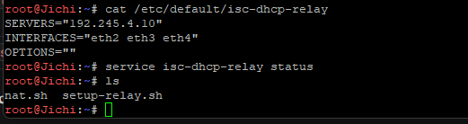

Perintah `pgrep -a dhcrelay` dipakai sebagai bukti, bukan `service isc-dhcp-relay status`, karena perintah status pada container ini tidak mengeluarkan output apa pun. Keluaran `pgrep` justru lebih informatif sebab menampilkan daftar interface dan alamat server dalam satu baris.

**Hasil pada client**

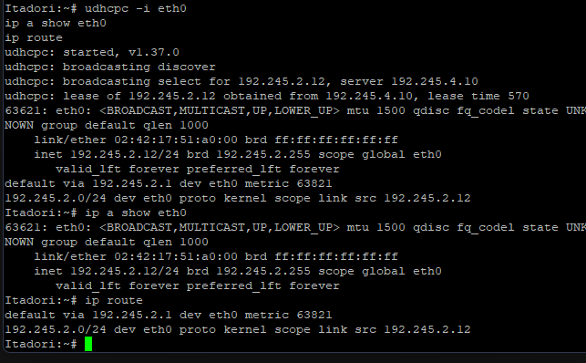

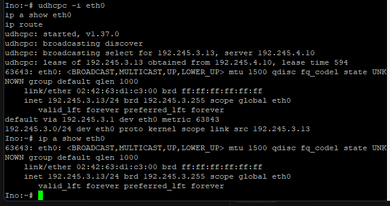

**Lease yang tercatat di tengen**

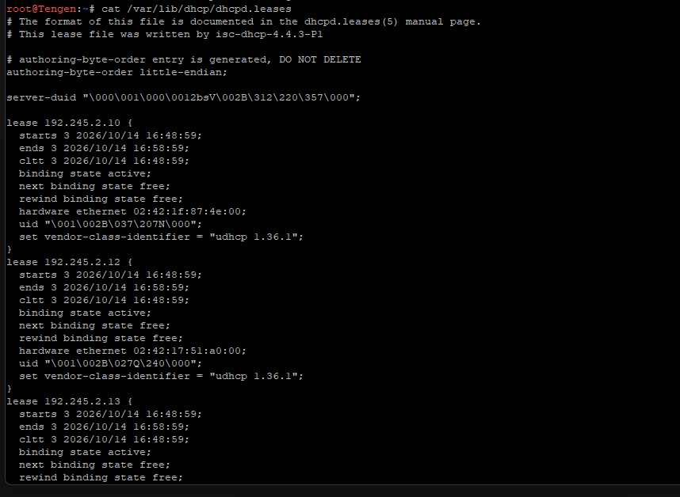

| Uji | Hasil |
|---|---|
| itadori, Network 2 | memperoleh `192.245.2.12`, gateway `192.245.2.1` |
| ino, Network 3 | memperoleh `192.245.3.13`, gateway `192.245.3.1` |
| Baris `server 192.245.4.10` pada keluaran udhcpc | jawaban berasal dari tengen di Network 4 |
| `dhcpd.leases` di tengen | terisi lease kedua client |

Baris `udhcpc: lease of 192.245.2.12 obtained from 192.245.4.10` menjadi bukti utama. Alamat server yang disebut adalah `tengen`, bukan `jichi`, padahal client berada di subnet yang berbeda dari server. Itu hanya mungkin apabila relay bekerja.

---

## Soal 4: Dua Pool DHCP dengan DHCP Class

### Soal

> Agar tim Dev dan Support di Divisi A menerima jatah alamat yang berbeda, atur dua pool DHCP pada Network 2. Tetapkan Pool 1 (192.245.2.10 sampai 192.245.2.35) untuk itadori dan fushiguro, serta Pool 2 (192.245.2.70 sampai 192.245.2.95) untuk zenin dan okkotsu. Rentang 192.245.2.36 sampai 192.245.2.69 tidak boleh dialokasikan. Karena seluruh client berada pada subnet yang sama, gunakan DHCP class berdasarkan MAC Address atau Client ID untuk memisahkan kedua kelompok.

### Inti Soal

Keempat client berada di subnet yang sama, sehingga server tidak bisa membedakan mereka berdasarkan asal subnet. Pembeda satu-satunya adalah identitas masing-masing client, yaitu MAC Address.

Penyelesaiannya memakai dua mekanisme:

1. **DHCP class** untuk mengelompokkan client berdasarkan MAC.
2. **Blok pool** di dalam subnet, masing-masing dibatasi dengan `allow members of` sehingga hanya melayani anggota kelas tertentu.

Rentang terlarang `192.245.2.36` sampai `192.245.2.69` tidak perlu dilarang secara khusus. Cukup tidak ditulis di `range` mana pun, maka alamat tersebut tidak akan pernah dialokasikan.

### Langkah Pengerjaan

**Langkah 1.** Kumpulkan MAC Address keempat client Network 2.

```bash
ip link show eth0 | grep link/ether
```

**Langkah 2.** Tulis dua `class` dan dua blok `pool` di dalam `dhcpd.conf`.

**Langkah 3.** Hapus lease lama di `tengen`. Langkah ini wajib, sebab keempat client saat itu memegang alamat `.2.10` sampai `.2.13` yang kebetulan seluruhnya masuk rentang Pool 1. Tanpa pembersihan, server akan memberikan alamat lama yang sama dan pengujian tidak membuktikan apa pun.

**Langkah 4.** Minta ulang alamat di keempat client.

### Konfigurasi

**tengen**, berkas `/root/setup-dhcp.sh`

```bash
cat > /root/setup-dhcp.sh <<'SCRIPT'
#!/bin/bash
export DEBIAN_FRONTEND=noninteractive
apt-get update -y
apt-get install -y isc-dhcp-server

cat > /etc/default/isc-dhcp-server <<'EOF'
INTERFACESv4="eth0"
INTERFACESv6=""
EOF

cat > /etc/dhcp/dhcpd.conf <<'EOF'
authoritative;

default-lease-time 600;
max-lease-time 7200;

option domain-name-servers 192.245.1.2, 192.245.1.3;

class "pool1" {
    match if (substring(hardware,1,6) = 02:42:17:51:a0:00)
         or (substring(hardware,1,6) = 02:42:1f:87:4e:00);
}

class "pool2" {
    match if (substring(hardware,1,6) = 02:42:e8:81:d1:00)
         or (substring(hardware,1,6) = 02:42:21:d8:76:00);
}

subnet 192.245.4.0 netmask 255.255.255.0 {
}

subnet 192.245.2.0 netmask 255.255.255.0 {
    option routers 192.245.2.1;
    option subnet-mask 255.255.255.0;
    option broadcast-address 192.245.2.255;

    pool {
        allow members of "pool1";
        range 192.245.2.10 192.245.2.35;
    }

    pool {
        allow members of "pool2";
        range 192.245.2.70 192.245.2.95;
    }
}

subnet 192.245.3.0 netmask 255.255.255.0 {
    range 192.245.3.10 192.245.3.89;
    option routers 192.245.3.1;
    option subnet-mask 255.255.255.0;
    option broadcast-address 192.245.3.255;
}
EOF

mkdir -p /var/lib/dhcp
touch /var/lib/dhcp/dhcpd.leases

dhcpd -t -cf /etc/dhcp/dhcpd.conf
service isc-dhcp-server restart
SCRIPT
chmod +x /root/setup-dhcp.sh
bash /root/setup-dhcp.sh
```

Ekspresi `substring(hardware,1,6)` dipakai karena field `hardware` pada ISC DHCP berukuran tujuh byte, yaitu satu byte tipe hardware diikuti enam byte MAC Address. Pengambilan dimulai dari offset 1 sepanjang 6 byte agar yang dibandingkan hanya MAC-nya.

**Pembersihan lease lama di tengen**

```bash
service isc-dhcp-server stop
echo -n > /var/lib/dhcp/dhcpd.leases
service isc-dhcp-server start
```

### Pengujian

```bash
# di keempat client Network 2
udhcpc -i eth0 -n
ip a show eth0
```

**MAC Address yang dikumpulkan**

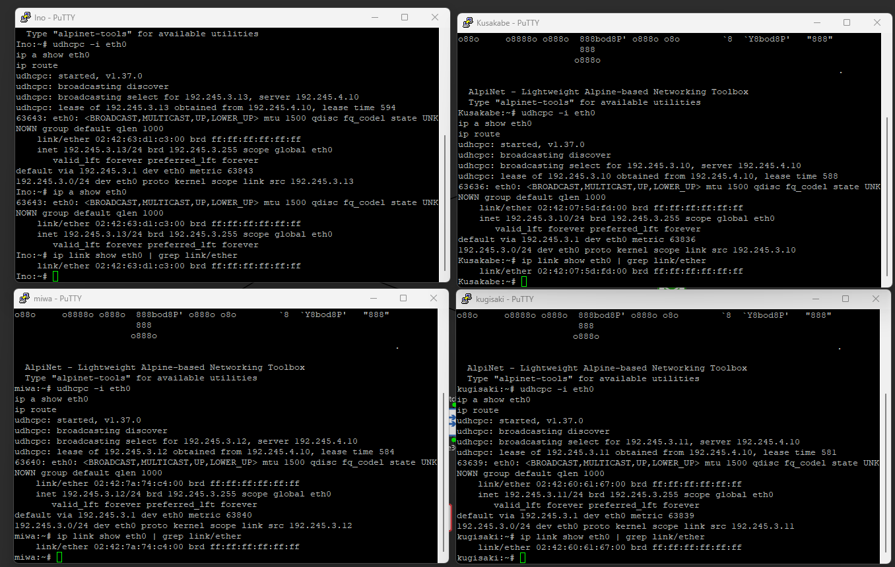

**Konfigurasi hasil**

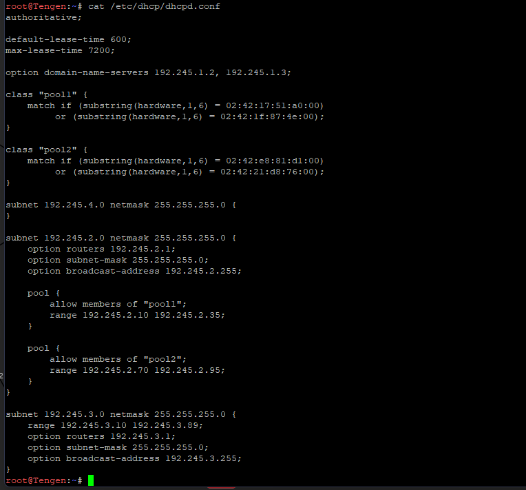

**Hasil Pool 1**

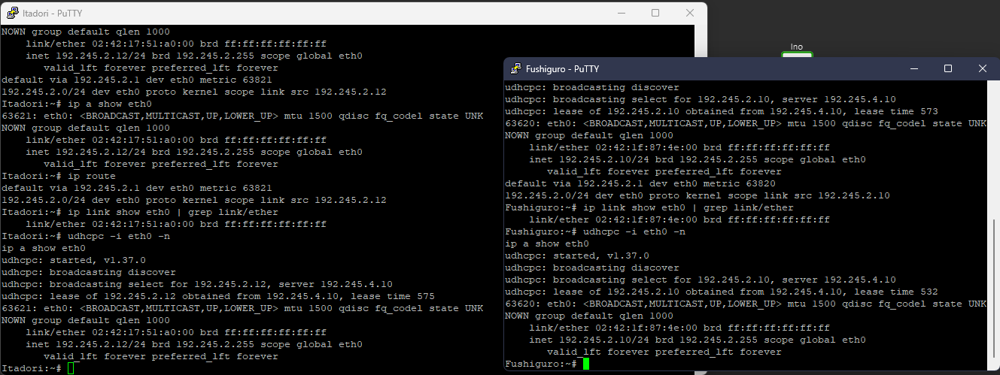

**Hasil Pool 2**

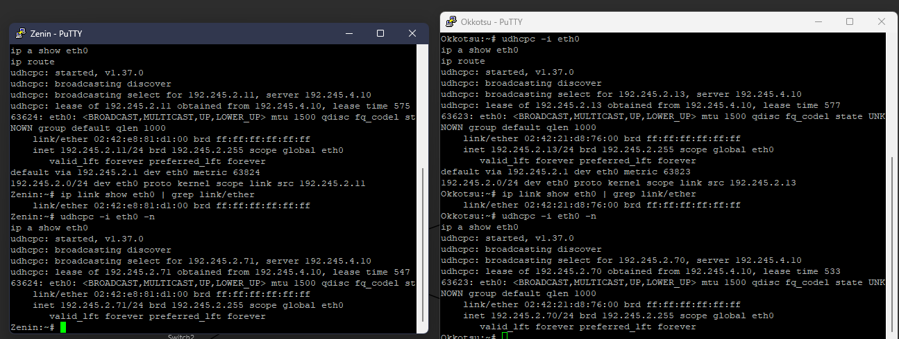

| Client | Alamat sebelum | Alamat sesudah | Pool |
|---|---|---|---|
| itadori | 192.245.2.12 | 192.245.2.12 | Pool 1 |
| fushiguro | 192.245.2.10 | 192.245.2.10 | Pool 1 |
| zenin | 192.245.2.11 | **192.245.2.71** | Pool 2 |
| okkotsu | 192.245.2.13 | **192.245.2.70** | Pool 2 |

Perpindahan zenin dan okkotsu keluar dari rentang lama merupakan bukti terkuat. Keduanya semula berada di `.2.11` dan `.2.13`, lalu setelah kelas diterapkan melompat ke `.2.71` dan `.2.70`. Perpindahan itu hanya mungkin terjadi apabila server benar-benar mencocokkan MAC mereka dengan kelas `pool2`.

---

## Soal 5: Short Lease, Long Lease, dan DHCP Options

### Soal

> Setiap tim lapangan memiliki durasi operasi yang berbeda. Pada Network 3, berikan short lease 30 menit (1800 detik) kepada ino dan kusakabe, serta long lease 12 jam (43200 detik) kepada miwa. Gunakan pool short lease 192.245.3.10 sampai 192.245.3.89 dan pool long lease 192.245.3.100 sampai 192.245.3.199. Sesuaikan default-lease-time dan max-lease-time untuk setiap kelas client. Berikan pula DHCP options berupa DNS 192.245.1.2 dan 192.245.1.3, serta domain-search K68.com.

### Inti Soal

Pola yang sama dengan soal 4, yaitu memisahkan client memakai DHCP class, tetapi dengan tambahan pengaturan durasi lease per pool. Nilai `default-lease-time` dan `max-lease-time` ditulis **di dalam blok pool**, bukan di tingkat global, sehingga setiap kelompok client memperoleh durasi yang berbeda.

Nilai `max-lease-time` sengaja disamakan dengan `default-lease-time` agar durasi yang diterima client pasti persis sesuai permintaan soal dan mudah dibuktikan dari keluaran `udhcpc`.

### Langkah Pengerjaan

**Langkah 1.** Tambahkan dua kelas baru untuk Network 3.

**Langkah 2.** Pecah subnet Network 3 menjadi dua blok pool dengan rentang dan durasi masing-masing.

**Langkah 3.** Tambahkan DHCP options berupa DNS dan domain-search.

**Langkah 4.** Hapus lease lama, lalu minta ulang alamat di client Network 3.

### Konfigurasi

**tengen**, berkas `/root/setup-dhcp.sh`, bagian yang berubah dari soal 4:

```
option domain-name-servers 192.245.1.2, 192.245.1.3;
option domain-search "K68.com";

class "shortlease" {
    match if (substring(hardware,1,6) = 02:42:63:d1:c3:00)
         or (substring(hardware,1,6) = 02:42:07:5d:fd:00);
}

class "longlease" {
    match if (substring(hardware,1,6) = 02:42:7a:74:c4:00);
}

subnet 192.245.3.0 netmask 255.255.255.0 {
    option routers 192.245.3.1;
    option subnet-mask 255.255.255.0;
    option broadcast-address 192.245.3.255;
    option domain-name-servers 192.245.1.2, 192.245.1.3;
    option domain-search "K68.com";

    pool {
        allow members of "shortlease";
        range 192.245.3.10 192.245.3.89;
        default-lease-time 1800;
        max-lease-time 1800;
    }

    pool {
        allow members of "longlease";
        range 192.245.3.100 192.245.3.199;
        default-lease-time 43200;
        max-lease-time 43200;
    }
}
```

Berkas lengkap versi final tersedia di `config/tengen/setup-dhcp.sh`.

### Pengujian

```bash
# di ino, kusakabe, dan miwa
udhcpc -i eth0 -n
ip a show eth0
cat /etc/resolv.conf
```

**Konfigurasi hasil**

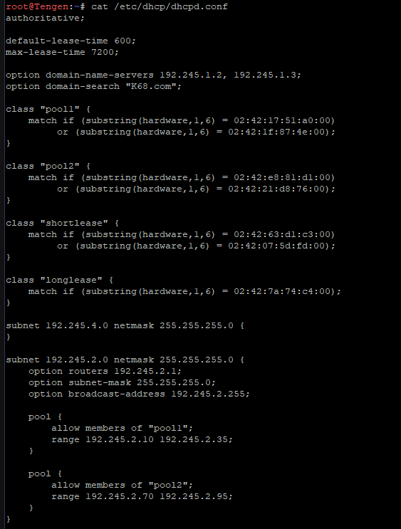

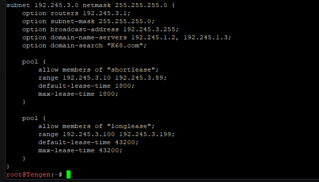

**Hasil short lease**

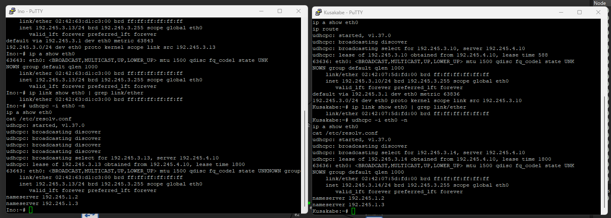

**Hasil long lease**

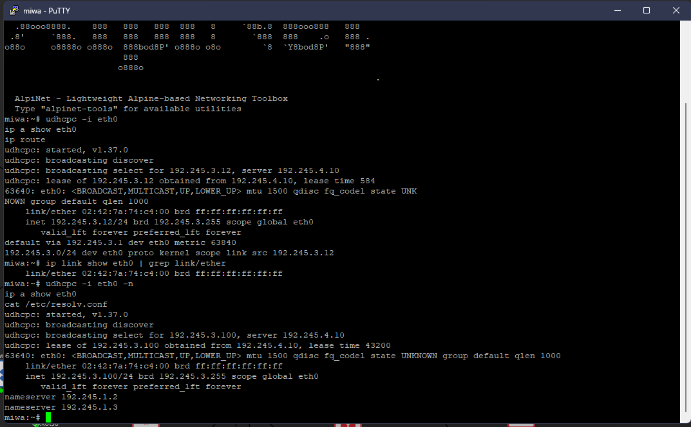

| Client | Alamat | Lease time | Pool |
|---|---|---|---|
| ino | 192.245.3.13 | 1800 | short |
| kusakabe | 192.245.3.14 | 1800 | short |
| miwa | 192.245.3.12 menjadi **192.245.3.100** | 43200 | long |

miwa berpindah keluar dari rentang short lease menuju rentang long lease, dan durasinya berubah menjadi 43200 detik. Itu bukti bahwa kelas dan pengaturan lease per pool bekerja.

### Temuan

Keluaran `cat /etc/resolv.conf` pada client hanya memuat dua baris `nameserver`, tanpa baris `search`. Penyebabnya, `udhcpc` dari BusyBox tidak memproses option 119 (`domain-search`), melainkan hanya option 15 (`domain-name`) ketika menuliskan baris `search`.

Perbaikannya dilakukan pada soal 6 dengan menambahkan `option domain-name "K68.com";`. Option `domain-search` tetap dipertahankan karena itulah yang diminta soal 5.

### Catatan Penting

Setelah soal 5 diterapkan, **kugisaki tidak memperoleh alamat sama sekali**. Keadaan itu normal dan bukan kesalahan. kugisaki tidak termasuk kelas `shortlease` maupun `longlease`, sedangkan kedua pool Network 3 memakai `allow members of`, sehingga tidak ada pool yang bersedia melayaninya. Alamatnya baru muncul pada soal 6 melalui reservasi berbasis MAC.

---

## Soal 6: Fixed Address untuk kugisaki

### Soal

> Kugisaki ditetapkan sebagai personel VIP yang harus mempertahankan alamat yang sama setiap kali terhubung. Buat DHCP static lease berdasarkan MAC Address client tersebut dengan fixed address 192.245.3.99. Pastikan alamat ini berada di luar seluruh pool dinamis, validasi konfigurasi server, lalu renew lease pada client. Buktikan bahwa alamat yang diterima sesuai dengan reservasi.

### Inti Soal

Reservasi alamat tetap berdasarkan MAC, dibuat melalui `host declaration` di luar blok `subnet`. Alamat `192.245.3.99` berada pada celah `.3.90` sampai `.3.99`, yaitu di luar pool short lease (`.3.10` sampai `.3.89`) dan di luar pool long lease (`.3.100` sampai `.3.199`), sesuai permintaan soal.

Perlu dibedakan dua hal yang sering tertukar:

| | Diatur di mana | Cara kerja |
|---|---|---|
| IP statis | di client, berkas `/etc/network/interfaces` | client menetapkan sendiri alamatnya |
| Fixed address | di **server**, berkas `dhcpd.conf` | client tetap meminta lewat DHCP, server selalu menjawab dengan alamat yang sama berdasarkan MAC |

Soal meminta yang kedua. Apabila dikerjakan sebagai IP statis di client, hasil `ip a` memang terlihat benar, tetapi soal tidak terpenuhi.

### Langkah Pengerjaan

**Langkah 1.** Tambahkan `host declaration` untuk kugisaki pada `dhcpd.conf`.

**Langkah 2.** Tambahkan sekalian `option domain-name "K68.com";` untuk memperbaiki temuan pada soal 5.

**Langkah 3.** Validasi konfigurasi, restart service, lalu renew lease pada kugisaki beberapa kali.

### Konfigurasi

**tengen**, berkas `/root/setup-dhcp.sh` versi final

```bash
cat > /root/setup-dhcp.sh <<'SCRIPT'
#!/bin/bash
export DEBIAN_FRONTEND=noninteractive
apt-get update -y
apt-get install -y isc-dhcp-server

cat > /etc/default/isc-dhcp-server <<'EOF'
INTERFACESv4="eth0"
INTERFACESv6=""
EOF

cat > /etc/dhcp/dhcpd.conf <<'EOF'
authoritative;

default-lease-time 600;
max-lease-time 7200;

option domain-name-servers 192.245.1.2, 192.245.1.3;
option domain-name "K68.com";
option domain-search "K68.com";

class "pool1" {
    match if (substring(hardware,1,6) = 02:42:17:51:a0:00)
         or (substring(hardware,1,6) = 02:42:1f:87:4e:00);
}

class "pool2" {
    match if (substring(hardware,1,6) = 02:42:e8:81:d1:00)
         or (substring(hardware,1,6) = 02:42:21:d8:76:00);
}

class "shortlease" {
    match if (substring(hardware,1,6) = 02:42:63:d1:c3:00)
         or (substring(hardware,1,6) = 02:42:07:5d:fd:00);
}

class "longlease" {
    match if (substring(hardware,1,6) = 02:42:7a:74:c4:00);
}

host kugisaki {
    hardware ethernet 02:42:60:61:67:00;
    fixed-address 192.245.3.99;
}

subnet 192.245.4.0 netmask 255.255.255.0 {
}

subnet 192.245.2.0 netmask 255.255.255.0 {
    option routers 192.245.2.1;
    option subnet-mask 255.255.255.0;
    option broadcast-address 192.245.2.255;

    pool {
        allow members of "pool1";
        range 192.245.2.10 192.245.2.35;
    }

    pool {
        allow members of "pool2";
        range 192.245.2.70 192.245.2.95;
    }
}

subnet 192.245.3.0 netmask 255.255.255.0 {
    option routers 192.245.3.1;
    option subnet-mask 255.255.255.0;
    option broadcast-address 192.245.3.255;
    option domain-name-servers 192.245.1.2, 192.245.1.3;
    option domain-name "K68.com";
    option domain-search "K68.com";

    pool {
        allow members of "shortlease";
        range 192.245.3.10 192.245.3.89;
        default-lease-time 1800;
        max-lease-time 1800;
    }

    pool {
        allow members of "longlease";
        range 192.245.3.100 192.245.3.199;
        default-lease-time 43200;
        max-lease-time 43200;
    }
}
EOF

mkdir -p /var/lib/dhcp
touch /var/lib/dhcp/dhcpd.leases

dhcpd -t -cf /etc/dhcp/dhcpd.conf
service isc-dhcp-server restart
SCRIPT
chmod +x /root/setup-dhcp.sh
bash /root/setup-dhcp.sh
```

Blok `host kugisaki` ditulis di luar seluruh blok `subnet`. ISC DHCP memproses `host declaration` secara terpisah dari pool, sehingga kugisaki tetap dilayani meskipun tidak termasuk kelas mana pun.

### Pengujian

```bash
# di kugisaki, diulang beberapa kali
udhcpc -i eth0 -n
ip a show eth0
cat /etc/resolv.conf
```

**Konfigurasi host declaration**

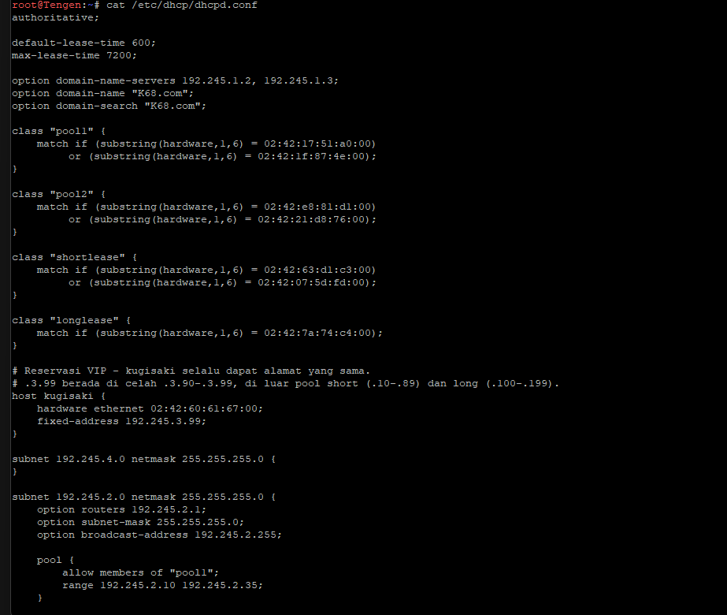

**Hasil pada kugisaki**

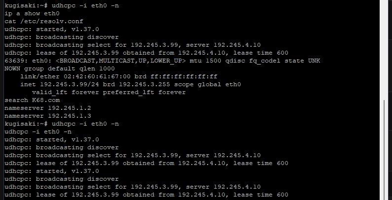

**Perbaikan baris search pada resolv.conf**

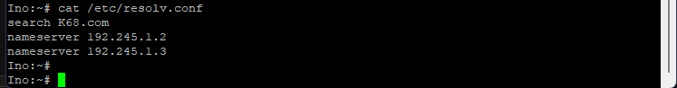

| Uji | Hasil |
|---|---|
| kugisaki meminta alamat, percobaan 1 | 192.245.3.99 |
| kugisaki meminta alamat, percobaan 2 | 192.245.3.99 |
| kugisaki meminta alamat, percobaan 3 | 192.245.3.99 |
| `cat /etc/resolv.conf` | sudah memuat `search K68.com` |

### Temuan

Perintah `grep 192.245.3.99 /var/lib/dhcp/dhcpd.leases` menghasilkan keluaran kosong, dan hal itu memang benar. Berkas `dhcpd.leases` hanya mencatat lease dinamis yang diambil dari pool. Reservasi melalui `host declaration` merupakan konfigurasi, bukan lease, sehingga tidak pernah dicatat di sana.

Lease time yang diterima kugisaki adalah 600 detik, yaitu nilai `default-lease-time` global, bukan 1800 atau 43200. Hal itu benar karena kugisaki berada di luar kedua blok pool, sehingga tidak terkena pengaturan lease milik pool mana pun. Soal juga tidak menentukan durasi lease untuk kugisaki.

---

## Soal 7: Verifikasi Konfigurasi Seluruh Client

### Soal

> Setelah aturan alokasi diterapkan, pastikan setiap client menerima konfigurasi jaringan sesuai wilayahnya: subnet mask 255.255.255.0 (/24), gateway dan broadcast address yang benar, DNS 192.245.1.2 serta 192.245.1.3, dan domain-search yang ditentukan. Periksa IP address dan routing seluruh client Divisi A dan Divisi B, kemudian cocokkan lease dengan /var/lib/dhcp/dhcpd.leases pada tengen. Pastikan tidak ada alamat yang bertabrakan atau berada di luar kebijakan pool.

### Inti Soal

Tidak ada konfigurasi baru. Soal ini murni verifikasi menyeluruh terhadap delapan client, dengan tiga hal yang harus dipastikan:

1. Setiap client menerima subnet mask, gateway, broadcast, DNS, dan domain-search yang benar.
2. Tidak ada alamat yang bertabrakan.
3. Tidak ada alamat yang berada di luar kebijakan pool.

### Langkah Pengerjaan

**Langkah 1.** Jalankan satu perintah gabungan pada setiap client agar seluruh informasi tampil ringkas dalam satu layar.

**Langkah 2.** Tampilkan daftar lease aktif pada `tengen`, lalu cocokkan.

### Perintah Pengujian

**Di setiap client**

```bash
echo "=== $(hostname) ==="; ip -4 addr show eth0 | grep inet; ip route | grep default; cat /etc/resolv.conf
```

**Di tengen**

```bash
awk '/^lease/{ip=$2} /binding state active/{print ip}' /var/lib/dhcp/dhcpd.leases | sort -u
```

Perintah `awk` dipakai agar keluaran hanya berisi daftar alamat yang berstatus aktif. Menampilkan isi `dhcpd.leases` secara utuh menghasilkan ratusan baris yang menyulitkan pencocokan.

### Pengujian

**Client Divisi A**

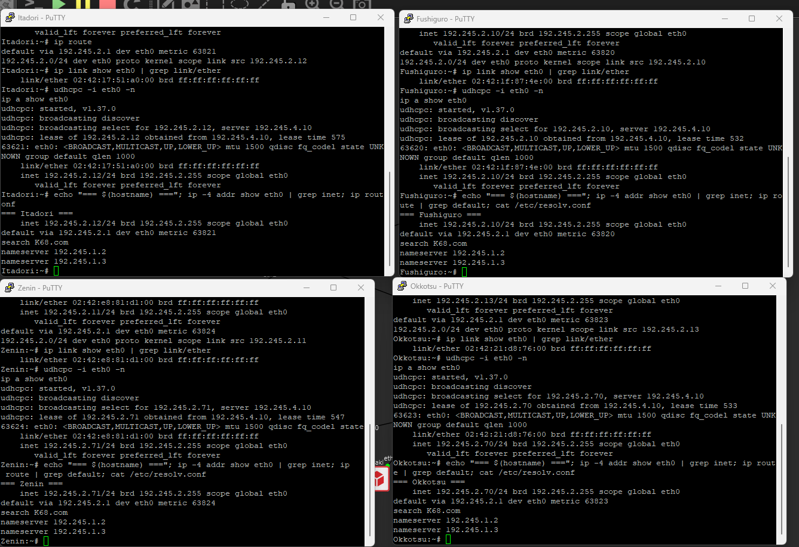

**Client Divisi B**

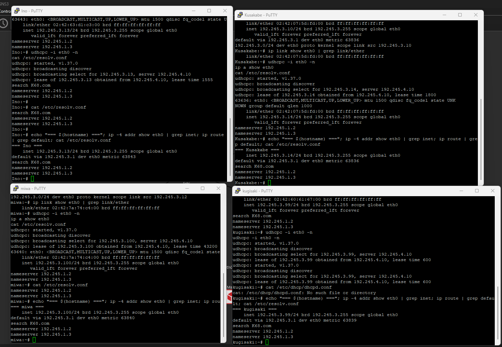

**Lease aktif di tengen**

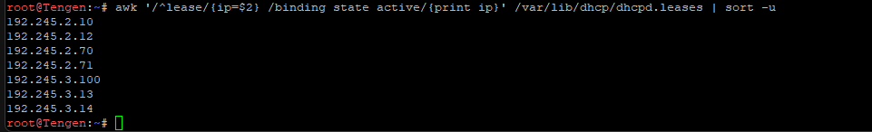

| Client | IP | Gateway | Broadcast | Kebijakan |
|---|---|---|---|---|
| itadori | 192.245.2.12 | 192.245.2.1 | 192.245.2.255 | Pool 1 |
| fushiguro | 192.245.2.10 | 192.245.2.1 | 192.245.2.255 | Pool 1 |
| zenin | 192.245.2.71 | 192.245.2.1 | 192.245.2.255 | Pool 2 |
| okkotsu | 192.245.2.70 | 192.245.2.1 | 192.245.2.255 | Pool 2 |
| ino | 192.245.3.13 | 192.245.3.1 | 192.245.3.255 | Short lease |
| kusakabe | 192.245.3.14 | 192.245.3.1 | 192.245.3.255 | Short lease |
| miwa | 192.245.3.100 | 192.245.3.1 | 192.245.3.255 | Long lease |
| kugisaki | 192.245.3.99 | 192.245.3.1 | 192.245.3.255 | Fixed address |

Seluruh client juga memuat `search K68.com` beserta dua baris nameserver `192.245.1.2` dan `192.245.1.3`.

Tiga hal yang diminta soal terpenuhi:

1. **Tidak ada tabrakan.** Delapan alamat di atas seluruhnya berbeda.
2. **Tidak ada yang di luar kebijakan.** Tidak satu pun alamat jatuh pada rentang terlarang `192.245.2.36` sampai `192.245.2.69`.
3. **Setiap client sesuai wilayahnya.** Client Network 2 memperoleh alamat `192.245.2.x`, client Network 3 memperoleh `192.245.3.x`.

Daftar lease aktif pada `tengen` berisi tujuh alamat, yaitu delapan client dikurangi kugisaki. kugisaki tidak muncul karena memakai `fixed-address` yang tidak dicatat sebagai lease dinamis.

### Temuan

Berkas `dhcpd.leases` memuat beberapa entri berstatus `binding state abandoned` untuk alamat `.3.10`, `.3.11`, dan `.3.12`. Entri tersebut merupakan sisa lease lama dari sebelum kebijakan pool diterapkan. Saat server hendak menawarkan alamat itu kepada client lain, server memeriksanya terlebih dahulu dan mendapati alamat tersebut masih terpakai oleh client lama yang belum melepas, sehingga ditandai `abandoned`.

Entri itu tidak mengganggu, sebab penyaringan `binding state active` sudah mengeluarkannya dari daftar, dan tidak ada satu pun alamat aktif yang bertabrakan.

---

## Soal 8: Packet Capture DORA dan giaddr

### Soal

> Sebelum Curtain dibuka kembali, buktikan bahwa proses pemberian alamat berjalan sesuai protokol. Lakukan packet capture saat salah satu client Network 2 atau Network 3 meminta lease baru. Gunakan tcpdump pada tengen atau jalur menuju Data Center untuk menunjukkan urutan DHCPDISCOVER, DHCPOFFER, DHCPREQUEST, DHCPACK. Identifikasi alamat server, alamat yang diberikan, lease time, dan field giaddr. Pastikan nilai giaddr sesuai dengan interface jichi yang menerima request dari subnet client.

### Inti Soal

Merekam empat paket pertukaran DHCP, lalu mengidentifikasi empat nilai di dalamnya. Nilai yang paling penting adalah `giaddr`, yaitu alamat interface relay yang menerima permintaan.

`giaddr` adalah mekanisme yang membuat satu server DHCP dapat melayani banyak subnet sekaligus. `tengen` tidak terhubung langsung ke Network 2 maupun Network 3, sehingga ia tidak dapat menebak asal permintaan dari alamat pengirim. Yang dibaca adalah `giaddr` yang disisipkan relay, lalu server memilih deklarasi subnet yang cocok dengan nilai tersebut.

### Langkah Pengerjaan

**Langkah 1.** Install `tcpdump` pada `tengen`, lalu mulai capture pada port DHCP.

**Langkah 2.** Pada jendela terpisah, minta lease baru dari salah satu client.

**Langkah 3.** Hentikan capture, lalu identifikasi keempat nilai yang diminta.

**Langkah 4.** Ulangi dengan client dari network yang berbeda untuk membuktikan `giaddr` memang mengikuti interface penerima.

### Perintah

**Di tengen**

```bash
apt-get install -y tcpdump
tcpdump -i eth0 -nv port 67 or port 68
```

**Di client**

```bash
udhcpc -i eth0 -n
```

### Pengujian

**Capture dari client Network 3, yaitu ino**

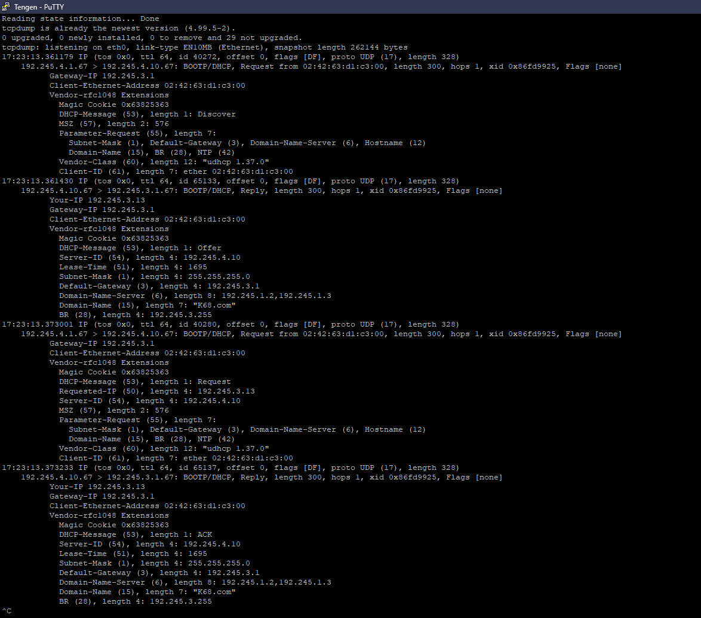

**Capture dari client Network 2, yaitu itadori**

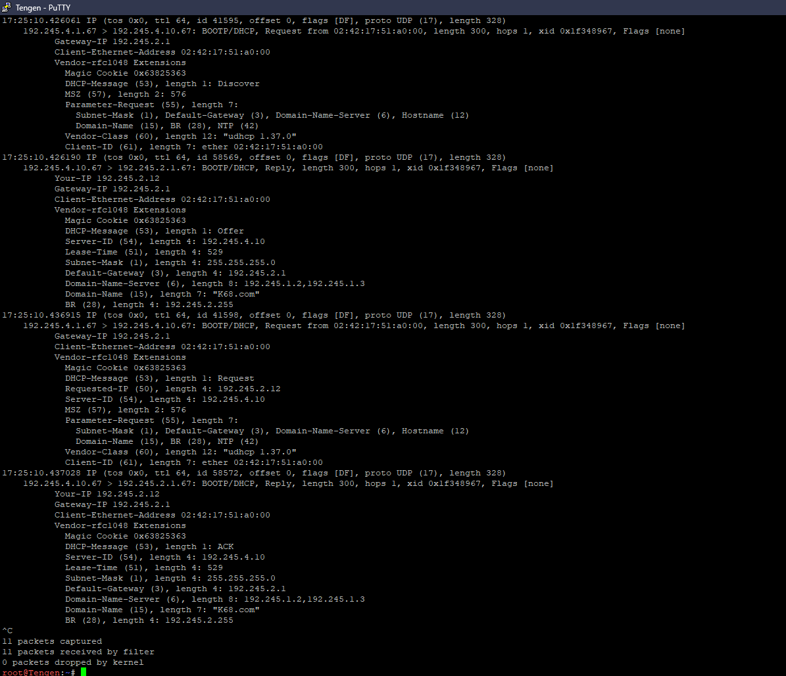

Urutan empat paket terekam lengkap pada kedua capture:

| Urutan | Arah | Jenis |
|---|---|---|
| 1 | jichi menuju tengen | DHCPDISCOVER |
| 2 | tengen menuju jichi | DHCPOFFER |
| 3 | jichi menuju tengen | DHCPREQUEST |
| 4 | tengen menuju jichi | DHCPACK |

Empat nilai yang diminta soal:

| Yang dicari | Field tcpdump | ino (Net 3) | itadori (Net 2) |
|---|---|---|---|
| Alamat server | `Server-ID`, option 54 | 192.245.4.10 | 192.245.4.10 |
| Alamat yang diberikan | `Your-IP` | 192.245.3.13 | 192.245.2.12 |
| Lease time | `Lease-Time`, option 51 | 1695 | 529 |
| **giaddr** | `Gateway-IP` | **192.245.3.1** | **192.245.2.1** |

Nilai `Gateway-IP` berubah mengikuti interface `jichi` yang menerima permintaan, yaitu `eth3` untuk Network 3 dan `eth2` untuk Network 2. Dua capture berdampingan itu membuktikan mekanisme `giaddr` bekerja sebagaimana mestinya.

Terlihat pula bahwa paket datang dari alamat `jichi`, bukan dari alamat client. Hal itu merupakan konsekuensi relay yang mengirim ulang broadcast client sebagai unicast atas namanya sendiri.

### Catatan

Nilai `Lease-Time` yang terekam adalah 1695 dan 529, bukan 1800 dan 600. Penyebabnya, kedua client sudah memegang lease sebelumnya, sehingga server memberikan **sisa waktu** lease yang masih berjalan, bukan menghitung ulang dari awal.

---

## Soal 9: Simulasi Gangguan Relay

### Soal

> Untuk menguji kesiapan pada kondisi darurat, lakukan simulasi gangguan dengan menghentikan layanan DHCP Relay pada jichi. Amati gejala yang muncul pada client, lalu aktifkan kembali layanan dan pastikan client dapat kembali memperoleh konfigurasi jaringan seperti semula.

### Inti Soal

Tiga tahap, yaitu matikan relay, amati gejala pada client, lalu nyalakan kembali dan buktikan client pulih. Yang dinilai adalah gejalanya, bukan sekadar perintah `stop` dan `start`.

Gejala yang diharapkan muncul karena permintaan DHCP dikirim secara **broadcast**, sedangkan broadcast tidak menyeberangi router. Tanpa relay, paket dari ino berhenti di `jichi` dan tidak pernah sampai ke `tengen` di Network 4, meskipun `tengen` sendiri tetap sehat.

### Langkah Pengerjaan

**Langkah 1.** Hentikan layanan relay pada `jichi`.

**Langkah 2.** Pada client ino, hapus alamat yang sudah dipegang, lalu minta alamat baru dengan batas percobaan pendek agar cepat menyerah.

**Langkah 3.** Nyalakan kembali relay pada `jichi`.

**Langkah 4.** Minta alamat lagi dari ino, lalu pastikan alamat dan gateway kembali seperti semula.

### Perintah

**Tahap 1, di jichi**

```bash
service isc-dhcp-relay stop
pgrep -a dhcrelay
```

**Tahap 2, di ino**

```bash
ip addr flush dev eth0
udhcpc -i eth0 -n -t 4 -T 2
ip a show eth0
```

Opsi `-t 4 -T 2` membatasi percobaan menjadi 4 kali dengan selang 2 detik, supaya `udhcpc` segera menyerah dan gejala kegagalan terlihat jelas tanpa menunggu lama.

**Tahap 3, di jichi**

```bash
service isc-dhcp-relay start
pgrep -a dhcrelay
```

**Tahap 4, di ino**

```bash
udhcpc -i eth0 -n
ip a show eth0
ip route
```

### Pengujian

**Relay dihentikan**

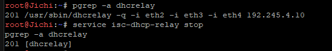

**Gejala pada client**

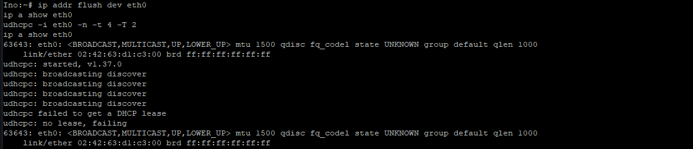

Gejala yang terekam:

1. Baris `broadcasting discover` tercetak empat kali berturut-turut.
2. Tidak ada satu pun baris `broadcasting select` ataupun `lease of ... obtained`.
3. Proses berakhir dengan `no lease, failing`.
4. Hasil `ip a` setelahnya tidak memuat alamat IPv4 sama sekali.

**Relay dinyalakan kembali**

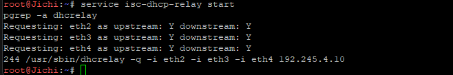

**Client pulih**

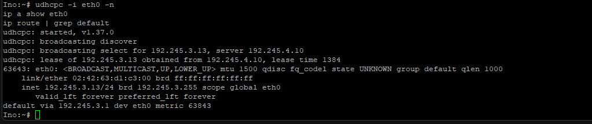

| Tahap | Hasil pada ino |
|---|---|
| Relay mati | tidak ada alamat IPv4, `no lease, failing` |
| Relay hidup | 192.245.3.13, dari pool short lease |
| Gateway setelah pulih | default via 192.245.3.1 |

### Catatan

Setelah `service isc-dhcp-relay stop`, perintah `pgrep -a dhcrelay` masih menampilkan `201 [dhcrelay]`. Tanda kurung siku berarti proses sudah mati tetapi belum dibersihkan dari tabel proses, yaitu kondisi defunct atau zombie, bukan berarti masih berjalan. Buktinya, setelah `start` nilai PID berubah dari 201 menjadi 244, yang berarti proses lama memang sudah hilang dan diganti proses baru.

Bukti yang paling kuat untuk soal ini bukan keluaran `pgrep`, melainkan gejala kegagalan total pada client.

---

## Soal 10: Autostart dan Uji Restart Node

### Soal

> Agar jaringan dapat kembali beroperasi tanpa intervensi manual, pastikan layanan DHCP Server pada tengen dan DHCP Relay pada jichi berjalan otomatis saat node dinyalakan. Lakukan uji restart node, kemudian buktikan bahwa seluruh client tetap memperoleh alamat sesuai kebijakan yang telah ditetapkan.

### Inti Soal

Memasang autostart, lalu benar-benar merestart node dan membuktikan seluruh kebijakan dari soal 2 sampai soal 6 tetap berlaku tanpa menjalankan satu pun script secara manual.

Pada lingkungan praktikum ini, saat node direstart yang hilang bukan hanya berkas konfigurasi, tetapi juga **paket yang sudah di-install**. Karena itu script autostart wajib memuat `apt-get install` di dalamnya, bukan hanya `service restart`.

Hanya dua lokasi yang bertahan, yaitu `/root` dan `/etc/network/interfaces`. Autostart dipasang dengan menambahkan baris `up bash /root/<script>.sh` pada berkas interfaces, karena berkas itu dibaca setiap kali interface dinyalakan.

### Langkah Pengerjaan

**Langkah 1.** Matikan node `tengen`, lalu edit `/etc/network/interfaces` melalui menu Edit network configuration dan tambahkan dua baris `up`.

**Langkah 2.** Lakukan hal yang sama pada `jichi`, dengan baris `up` ditaruh pada blok `eth4`.

**Langkah 3.** Nyalakan kedua node, tunggu dua sampai tiga menit sampai proses install selesai.

**Langkah 4.** Verifikasi tanpa menjalankan script apa pun secara manual.

**Langkah 5.** Minta lease baru dari seluruh client, lalu cocokkan dengan kelima kebijakan.

### Konfigurasi

**tengen**, berkas `/etc/network/interfaces`

```
auto eth0
iface eth0 inet static
	address 192.245.4.10
	netmask 255.255.255.0
	gateway 192.245.4.1
	up bash /root/dns.sh
	up bash /root/setup-dhcp.sh
```

Urutan dua baris `up` itu penting. Berkas `dns.sh` memasang resolver terlebih dahulu, sebab `setup-dhcp.sh` memuat `apt-get` yang membutuhkan DNS agar dapat menjangkau repositori.

**jichi**, berkas `/etc/network/interfaces`

```
auto eth0
iface eth0 inet dhcp
	up bash /root/nat.sh

auto eth1
iface eth1 inet static
	address 192.245.1.1
	netmask 255.255.255.0

auto eth2
iface eth2 inet static
	address 192.245.2.1
	netmask 255.255.255.0

auto eth3
iface eth3 inet static
	address 192.245.3.1
	netmask 255.255.255.0

auto eth4
iface eth4 inet static
	address 192.245.4.1
	netmask 255.255.255.0
	up bash /root/setup-relay.sh
```

Baris `up bash /root/setup-relay.sh` sengaja diletakkan pada blok `eth4`, bukan `eth0`. Berkas interfaces diproses dari atas ke bawah, sehingga saat blok `eth4` dijalankan, interface `eth2`, `eth3`, dan `eth4` sudah hidup. Relay membutuhkan ketiganya karena berkas `/etc/default/isc-dhcp-relay` menyebut `INTERFACES="eth2 eth3 eth4"`. Apabila ditaruh pada `eth0`, relay akan dijalankan saat `eth2` sampai `eth4` belum ada, dan daemon gagal mengikat interface.

Perlu diingat, editor Edit network configuration pada GNS3 membuang baris yang memuat karakter `>`. Oleh sebab itu seluruh perintah redirect disembunyikan di dalam berkas `.sh` di `/root`, dan interfaces hanya memanggilnya.

### Pengujian

**Verifikasi di jichi setelah restart**

```bash
pgrep -a dhcrelay
iptables -t nat -L POSTROUTING -n -v
ip -4 addr show eth4
```

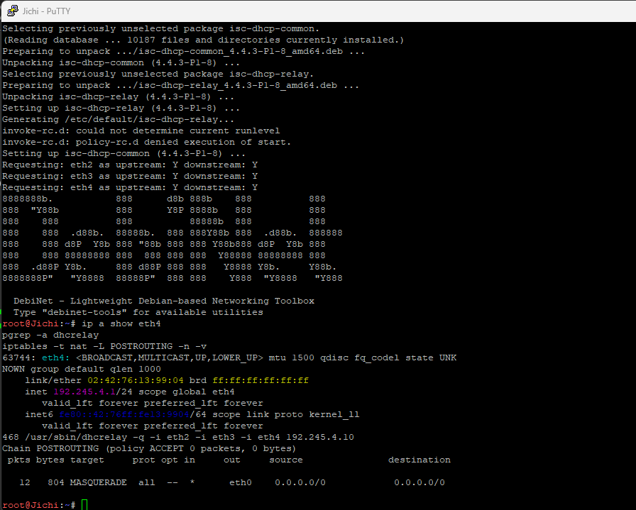

**Verifikasi di tengen setelah restart**

```bash
service isc-dhcp-server status
cat /etc/dhcp/dhcpd.conf
```

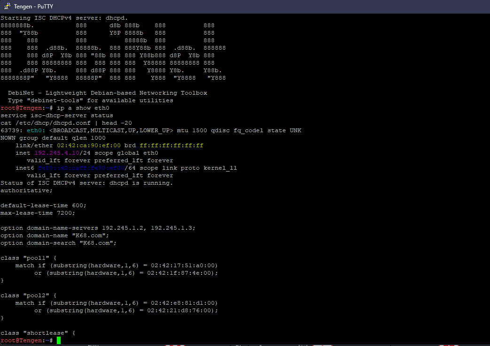

**Kebijakan Network 2 setelah restart**

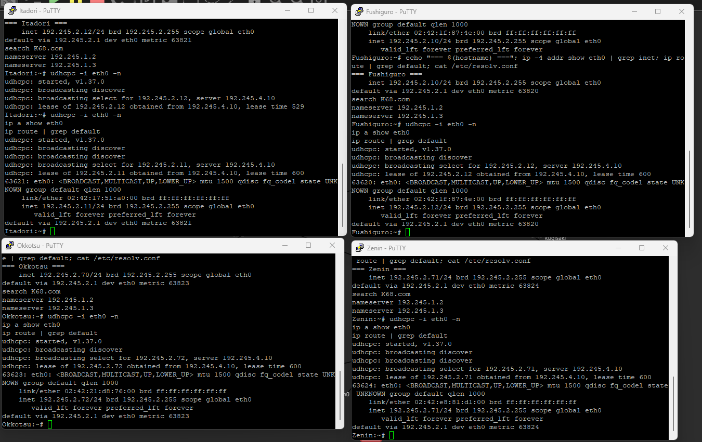

**Kebijakan Network 3 setelah restart**

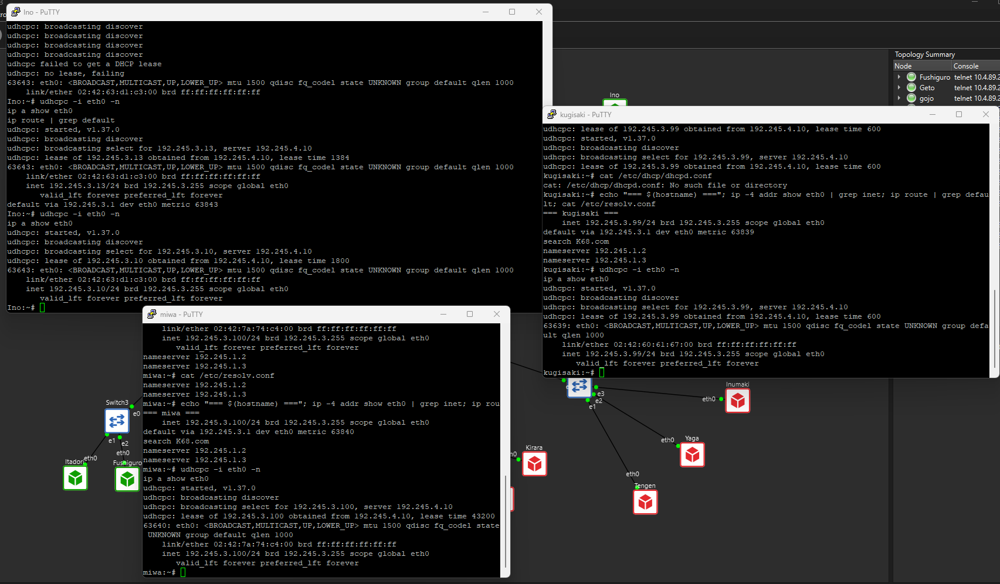

Hasil verifikasi tanpa intervensi manual sama sekali:

| Yang diperiksa | Hasil |
|---|---|
| dhcrelay di jichi | hidup sendiri, PID 468 |
| MASQUERADE di jichi | terpasang, 12 paket tercatat lewat |
| eth4 jichi | 192.245.4.1 |
| dhcpd di tengen | running |
| dhcpd.conf di tengen | lengkap, termasuk seluruh deklarasi class |

Kelima kebijakan alokasi tetap berlaku:

| Kebijakan | Client | Alamat | Lease |
|---|---|---|---|
| Pool 1 | itadori | 192.245.2.11 | 600 |
| Pool 1 | fushiguro | 192.245.2.12 | 600 |
| Pool 2 | zenin | 192.245.2.71 | 600 |
| Pool 2 | okkotsu | 192.245.2.72 | 600 |
| Short lease | ino | 192.245.3.10 | 1800 |
| Long lease | miwa | 192.245.3.100 | 43200 |
| Fixed address | kugisaki | 192.245.3.99 | 600 |

### Catatan

Alamat pada Network 2 bergeser dibandingkan sebelum restart, misalnya itadori dari `.2.12` menjadi `.2.11` dan okkotsu dari `.2.70` menjadi `.2.72`. Penyebabnya, berkas `/var/lib/dhcp/dhcpd.leases` ikut terhapus saat node direstart, sehingga server membagikan ulang alamat secara bebas **di dalam** pool masing-masing. Pergeseran itu bukan kesalahan, sebab yang ditentukan soal adalah rentang pool per client, bukan angka pasti.

---

## Soal 11: DNS Master dan Slave

### Soal

> Bangun layanan DNS internal untuk domain jujutsu.K68.com. utahime berperan sebagai DNS master dan shoko sebagai DNS slave. Pastikan kedua server memiliki data zona yang konsisten, slave memperoleh data melalui zone transfer dari master, dan perubahan pada master terbawa ke slave secara otomatis.

### Inti Soal

Membangun BIND9 pada dua node dengan relasi master dan slave, lalu membuktikan bahwa zone transfer berjalan otomatis. Bukti yang dinilai bukan sekadar kedua server dapat menjawab query, melainkan bahwa **perubahan pada master terbawa ke slave tanpa slave disentuh**.

Mekanismenya bersandar pada nomor `Serial` di dalam record SOA. Setiap kali isi zona diubah, serial harus dinaikkan. Master mengirim notify, slave membandingkan serial miliknya dengan serial master, dan apabila serial master lebih besar barulah slave menarik salinan baru. Apabila serial tidak dinaikkan, slave menganggap datanya sudah mutakhir dan tidak melakukan apa pun, meskipun isi zona di master sudah berbeda.

Seluruh konfigurasi ditulis melalui `/root/setup-dns.sh` karena direktori `/etc/bind` hilang setiap kali node direstart.

### Langkah Pengerjaan

**Langkah 1.** Tulis `setup-dns.sh` pada `utahime` yang memuat install BIND9, `named.conf.local` bertipe master, `named.conf.options`, dan berkas zona.

**Langkah 2.** Tulis `setup-dns.sh` pada `shoko` yang memuat `named.conf.local` bertipe slave dengan `masters` menunjuk ke `192.245.1.2`.

**Langkah 3.** Jalankan kedua script, lalu uji dengan `dig` ke kedua server.

**Langkah 4.** Naikkan serial pada master, jalankan ulang script master, lalu buktikan serial pada slave ikut naik tanpa disentuh.

### Konfigurasi

**utahime**, berkas `/root/setup-dns.sh`

```bash
cat > /root/setup-dns.sh <<'SCRIPT'
#!/bin/bash
export DEBIAN_FRONTEND=noninteractive
apt-get update -y
apt-get install -y bind9 dnsutils
ln -sf /etc/init.d/named /etc/init.d/bind9
mkdir -p /etc/bind/jarkom

cat > /etc/bind/named.conf.local <<'EOF'
zone "jujutsu.K68.com" {
    type master;
    notify yes;
    also-notify { 192.245.1.3; };
    allow-transfer { 192.245.1.3; };
    file "/etc/bind/jarkom/jujutsu.K68.com";
};
EOF

cat > /etc/bind/named.conf.options <<'EOF'
options {
    directory "/var/cache/bind";
    dnssec-validation no;
    allow-query { any; };
    auth-nxdomain no;
    listen-on-v6 { any; };
};
EOF

cat > /etc/bind/jarkom/jujutsu.K68.com <<'EOF'
$TTL    604800
@       IN      SOA     utahime.jujutsu.K68.com. root.jujutsu.K68.com. (
                        2026101501 ; Serial
                        604800     ; Refresh
                        86400      ; Retry
                        2419200    ; Expire
                        604800 )   ; Negative Cache TTL
;
@       IN      NS      utahime.jujutsu.K68.com.
@       IN      NS      shoko.jujutsu.K68.com.

utahime IN      A       192.245.1.2
shoko   IN      A       192.245.1.3
EOF

service bind9 restart
SCRIPT
chmod +x /root/setup-dns.sh
bash /root/setup-dns.sh
```

Arti tiga direktif transfer pada blok zona master:

| Direktif | Fungsi |
|---|---|
| `notify yes` | master memberi tahu slave setiap kali zona berubah |
| `also-notify { 192.245.1.3; }` | tujuan notify ditegaskan ke alamat shoko |
| `allow-transfer { 192.245.1.3; }` | hanya shoko yang diizinkan menarik salinan zona |

**shoko**, berkas `/root/setup-dns.sh`

```bash
cat > /root/setup-dns.sh <<'SCRIPT'
#!/bin/bash
export DEBIAN_FRONTEND=noninteractive
apt-get update -y
apt-get install -y bind9 dnsutils
ln -sf /etc/init.d/named /etc/init.d/bind9
mkdir -p /etc/bind/jarkom
chown -R bind:bind /etc/bind/jarkom

cat > /etc/bind/named.conf.local <<'EOF'
zone "jujutsu.K68.com" {
    type slave;
    masters { 192.245.1.2; };
    file "/etc/bind/jarkom/jujutsu.K68.com";
};
EOF

cat > /etc/bind/named.conf.options <<'EOF'
options {
    directory "/var/cache/bind";
    dnssec-validation no;
    allow-query { any; };
    auth-nxdomain no;
    listen-on-v6 { any; };
};
EOF

service bind9 restart
SCRIPT
chmod +x /root/setup-dns.sh
bash /root/setup-dns.sh
```

Baris `chown -R bind:bind /etc/bind/jarkom` bersifat wajib. Berkas hasil zone transfer ditulis oleh proses `named` yang berjalan sebagai user `bind`, sehingga direktori tujuannya harus dimiliki user tersebut. Tanpa baris itu transfer gagal dengan galat permission denied dan slave tetap kosong.

### Pengujian

**Konfigurasi master**

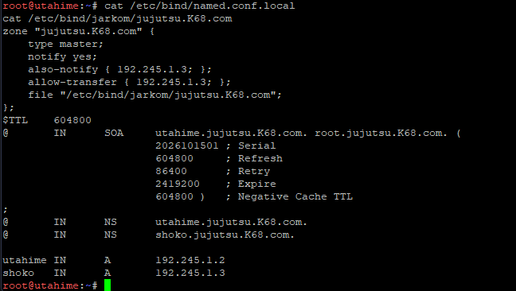

**Konfigurasi slave**

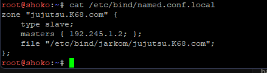

```bash
dig @192.245.1.2 jujutsu.K68.com NS
dig @192.245.1.3 jujutsu.K68.com NS
```

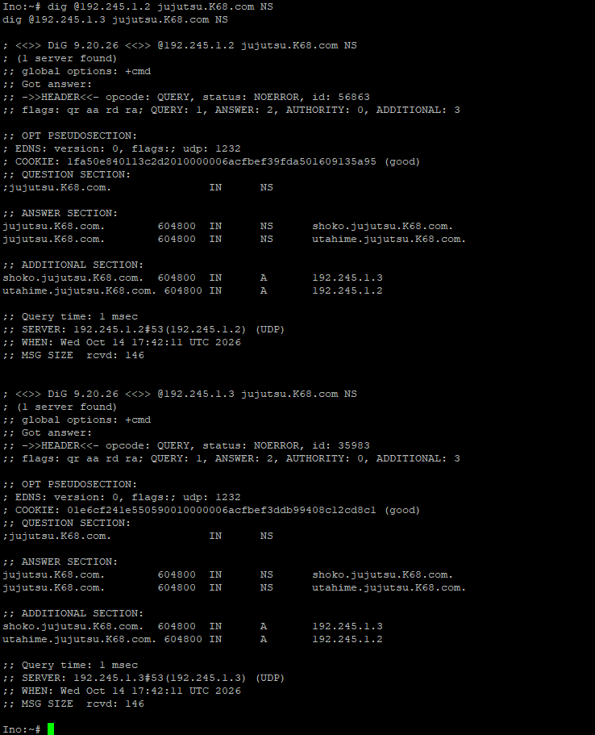

Kedua server menjawab dengan flag `aa`, yaitu authoritative answer, dan `ANSWER: 2` yang berisi kedua nameserver. Flag `aa` penting karena membuktikan server menjawab dari data zona yang dimilikinya sendiri, bukan dari cache.

**Uji sinkronisasi dengan menaikkan serial**

```bash
# di utahime, ubah serial menjadi 2026101502 di dalam setup-dns.sh
bash /root/setup-dns.sh

# lalu dari mana saja
dig @192.245.1.2 jujutsu.K68.com SOA +short
dig @192.245.1.3 jujutsu.K68.com SOA +short
```

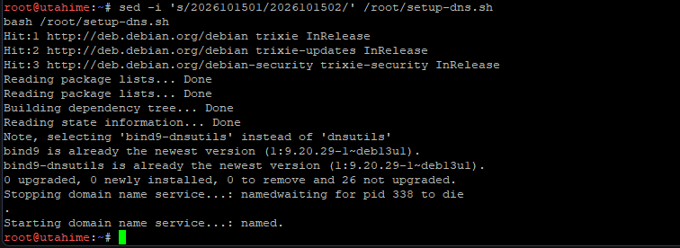

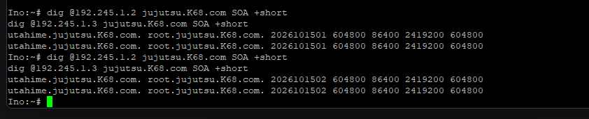

| Keadaan | Serial utahime | Serial shoko |
|---|---|---|
| Sebelum | 2026101501 | 2026101501 |
| Sesudah | 2026101502 | 2026101502 |

Serial pada shoko ikut naik tanpa satu pun perintah dijalankan di sana. Itu bukti bahwa zone transfer otomatis bekerja.

### Catatan

Jangan menampilkan berkas zona di sisi slave dengan `cat`. BIND menyimpan zona hasil transfer dalam format raw atau biner, sehingga keluarannya berupa karakter acak. Untuk membuktikan peran slave, cukup tampilkan `named.conf.local` yang memperlihatkan `type slave`, lalu buktikan isi datanya melalui `dig`.

Hal yang sama berlaku pada `named-checkzone` di slave, yang selalu menghasilkan galat palsu untuk alasan yang sama.

---

## Soal 12: A Record, CNAME, Reverse Zone, dan Forwarder

### Soal

> Tambahkan konfigurasi DNS agar domain jujutsu.K68.com mengarah ke gojo sebagai titik masuk publik, buat alias www yang mengarah ke domain utama, siapkan reverse zone agar IP gojo dapat dilacak kembali ke domain resminya, dan tambahkan forwarder agar client tetap dapat melakukan resolusi domain internet.

### Inti Soal

Empat penambahan pada DNS yang sudah berdiri di soal 11:

| Yang diminta | Jenis record | Isi |
|---|---|---|
| Domain mengarah ke gojo | A pada apex | `@ IN A 192.245.1.4` |
| Alias www | CNAME | `www IN CNAME jujutsu.K68.com.` |
| IP gojo dilacak ke domain | zona reverse berisi PTR | `4 IN PTR jujutsu.K68.com.` |
| Resolusi domain internet | `forwarders` | `192.168.122.1` |

Reverse zone adalah zona terpisah bernama `1.245.192.in-addr.arpa`, yaitu tiga oktet pertama alamat yang dibalik urutannya. Zona itu memetakan alamat kembali ke nama, berlawanan arah dengan zona forward.

Record PTR untuk `.1.4` diarahkan ke `jujutsu.K68.com.`, bukan ke `gojo.jujutsu.K68.com.`, karena soal meminta IP gojo dilacak kembali ke **domain resminya**, dan domain yang memetakan ke alamat itu adalah `jujutsu.K68.com`.

Seluruh penambahan dikerjakan dengan menyunting `setup-dns.sh` lalu menjalankannya ulang, dan serial dinaikkan menjadi `2026101503` supaya shoko ikut memperbarui salinannya.

### Langkah Pengerjaan

**Langkah 1.** Tambahkan deklarasi zona reverse pada `named.conf.local` di `utahime`, dengan direktif transfer yang sama seperti zona forward.

**Langkah 2.** Tambahkan blok `forwarders` pada `named.conf.options` di kedua node.

**Langkah 3.** Tambahkan A record apex, A record gojo, dan CNAME www pada zona forward, lalu naikkan serial.

**Langkah 4.** Buat berkas zona reverse berisi tiga record PTR.

**Langkah 5.** Tambahkan deklarasi zona reverse bertipe slave pada `shoko`.

**Langkah 6.** Jalankan ulang kedua script, lalu uji seluruhnya dari client.

### Konfigurasi

**utahime**, berkas `/root/setup-dns.sh` versi final

```bash
cat > /root/setup-dns.sh <<'SCRIPT'
#!/bin/bash
export DEBIAN_FRONTEND=noninteractive
apt-get update -y
apt-get install -y bind9 dnsutils
ln -sf /etc/init.d/named /etc/init.d/bind9
mkdir -p /etc/bind/jarkom

cat > /etc/bind/named.conf.local <<'EOF'
zone "jujutsu.K68.com" {
    type master;
    notify yes;
    also-notify { 192.245.1.3; };
    allow-transfer { 192.245.1.3; };
    file "/etc/bind/jarkom/jujutsu.K68.com";
};

zone "1.245.192.in-addr.arpa" {
    type master;
    notify yes;
    also-notify { 192.245.1.3; };
    allow-transfer { 192.245.1.3; };
    file "/etc/bind/jarkom/1.245.192.in-addr.arpa";
};
EOF

cat > /etc/bind/named.conf.options <<'EOF'
options {
    directory "/var/cache/bind";
    forwarders {
        192.168.122.1;
    };
    dnssec-validation no;
    allow-query { any; };
    auth-nxdomain no;
    listen-on-v6 { any; };
};
EOF

cat > /etc/bind/jarkom/jujutsu.K68.com <<'EOF'
$TTL    604800
@       IN      SOA     utahime.jujutsu.K68.com. root.jujutsu.K68.com. (
                        2026101503 ; Serial
                        604800     ; Refresh
                        86400      ; Retry
                        2419200    ; Expire
                        604800 )   ; Negative Cache TTL
;
@       IN      NS      utahime.jujutsu.K68.com.
@       IN      NS      shoko.jujutsu.K68.com.

@       IN      A       192.245.1.4

utahime IN      A       192.245.1.2
shoko   IN      A       192.245.1.3
gojo    IN      A       192.245.1.4

www     IN      CNAME   jujutsu.K68.com.
EOF

cat > /etc/bind/jarkom/1.245.192.in-addr.arpa <<'EOF'
$TTL    604800
@       IN      SOA     utahime.jujutsu.K68.com. root.jujutsu.K68.com. (
                        2026101503 ; Serial
                        604800     ; Refresh
                        86400      ; Retry
                        2419200    ; Expire
                        604800 )   ; Negative Cache TTL
;
@       IN      NS      utahime.jujutsu.K68.com.
@       IN      NS      shoko.jujutsu.K68.com.

2       IN      PTR     utahime.jujutsu.K68.com.
3       IN      PTR     shoko.jujutsu.K68.com.
4       IN      PTR     jujutsu.K68.com.
EOF

service bind9 restart
SCRIPT
chmod +x /root/setup-dns.sh
bash /root/setup-dns.sh
```

**shoko**, berkas `/root/setup-dns.sh` versi final

```bash
cat > /root/setup-dns.sh <<'SCRIPT'
#!/bin/bash
export DEBIAN_FRONTEND=noninteractive
apt-get update -y
apt-get install -y bind9 dnsutils
ln -sf /etc/init.d/named /etc/init.d/bind9
mkdir -p /etc/bind/jarkom
chown -R bind:bind /etc/bind/jarkom

cat > /etc/bind/named.conf.local <<'EOF'
zone "jujutsu.K68.com" {
    type slave;
    masters { 192.245.1.2; };
    file "/etc/bind/jarkom/jujutsu.K68.com";
};

zone "1.245.192.in-addr.arpa" {
    type slave;
    masters { 192.245.1.2; };
    file "/etc/bind/jarkom/1.245.192.in-addr.arpa";
};
EOF

cat > /etc/bind/named.conf.options <<'EOF'
options {
    directory "/var/cache/bind";
    forwarders {
        192.168.122.1;
    };
    dnssec-validation no;
    allow-query { any; };
    auth-nxdomain no;
    listen-on-v6 { any; };
};
EOF

service bind9 restart
SCRIPT
chmod +x /root/setup-dns.sh
bash /root/setup-dns.sh
```

Titik di akhir `jujutsu.K68.com.` pada record CNAME bersifat wajib. Tanpa titik, BIND menganggap nama itu relatif terhadap zona dan menambahkan nama zona di belakangnya, sehingga hasilnya menjadi `jujutsu.K68.com.jujutsu.K68.com` yang tidak pernah bisa diresolusi.

Untuk menampilkan isi konfigurasi, gunakan jalur lengkapnya:

```bash
cat /etc/bind/named.conf.local
cat /etc/bind/named.conf.options
cat /etc/bind/jarkom/jujutsu.K68.com
cat /etc/bind/jarkom/1.245.192.in-addr.arpa
```

### Pengujian

**Zona forward dengan A record apex dan CNAME www**

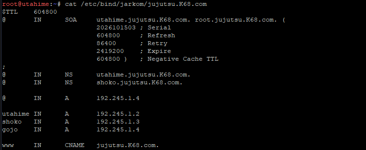

**Zona reverse berisi record PTR**

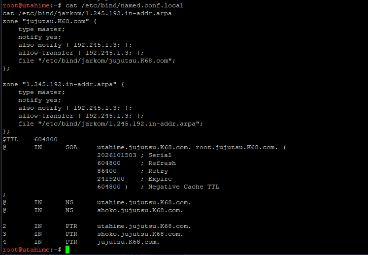

**Blok forwarders pada named.conf.options**

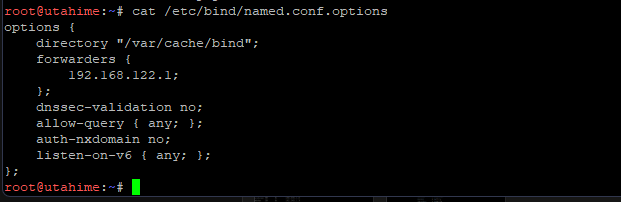

**Pengujian dari client ino**

```bash
dig jujutsu.K68.com +short
dig www.jujutsu.K68.com
dig -x 192.245.1.4 +short
ping -c 3 google.com
```

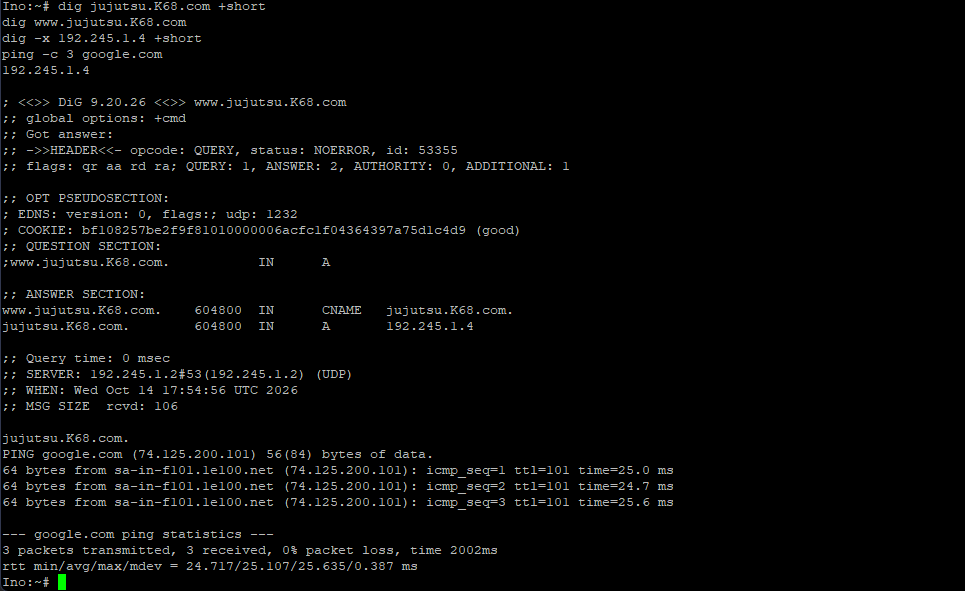

| Uji | Hasil | Membuktikan |
|---|---|---|
| `dig jujutsu.K68.com +short` | 192.245.1.4 | A record apex mengarah ke gojo |
| `dig www.jujutsu.K68.com` | CNAME ke `jujutsu.K68.com.` lalu A 192.245.1.4, flag `aa` | alias www bekerja |
| `dig -x 192.245.1.4 +short` | `jujutsu.K68.com.` | reverse zone bekerja |
| `ping -c 3 google.com` | 3 received, 0% packet loss | forwarder bekerja |

Pengujian dilakukan dari client, bukan dari server DNS, karena dengan demikian sekalian terbukti bahwa resolver yang dibagikan DHCP pada soal 2 memang mengarah ke kedua server tersebut.

### Catatan

Perintah `ping` pada node alpinet berasal dari BusyBox, dan BusyBox mengharuskan opsi ditulis **sebelum** target.

```bash
ping google.com -c 3    # salah, menghasilkan "ping: -c: Name does not resolve"
ping -c 3 google.com    # benar
```

Pada node debinet urutannya bebas, pada alpinet tidak. Galat `Name does not resolve` pada kasus itu bukan tanda DNS bermasalah, melainkan karena BusyBox membaca `-c` sebagai nama host yang hendak diping.

---

## Soal 13: Replikasi Database MariaDB

### Soal

> Siapkan layanan database untuk mencatat aktivitas sistem. yaga berperan sebagai database master dan inumaki sebagai database slave. Buat database db_shibuya_K68 beserta tabel request_logs, aktifkan replikasi dari master ke slave, dan pastikan database dapat diakses dari node lain dalam Network Data Center.

### Inti Soal

Empat hal yang harus terpenuhi:

1. Replikasi master ke slave aktif, yaitu `yaga` menuju `inumaki`.
2. Database `db_shibuya_K68` beserta tabel `request_logs` tersedia.
3. Database dapat diakses dari node lain di Network 4, bukan hanya dari localhost.
4. Data yang ditulis di master terbawa ke slave.

Urutan pengerjaan menentukan keberhasilan. Replikasi dinyalakan **terlebih dahulu**, baru kemudian database dan tabel dibuat di master. Dengan urutan itu perintah DDL `CREATE DATABASE` dan `CREATE TABLE` ikut tereplikasi, sehingga struktur tabel muncul sendiri di slave. Apabila database dibuat sebelum `START SLAVE`, slave mulai membaca dari posisi binlog setelahnya dan tabel tidak akan pernah ada di sana.

### Langkah Pengerjaan

**Langkah 1.** Install MariaDB dan tulis konfigurasi master pada `yaga`, termasuk pembuatan user remote.

**Langkah 2.** Install MariaDB dan tulis konfigurasi slave pada `inumaki`.

**Langkah 3.** Baca posisi binlog master dengan `SHOW MASTER STATUS` di `yaga`.

**Langkah 4.** Sambungkan slave dengan `CHANGE MASTER TO` memakai posisi tersebut, lalu `START SLAVE`.

**Langkah 5.** Buat database dan tabel di master, lalu buktikan keduanya muncul di slave tanpa dibuat manual.

**Langkah 6.** Masukkan satu baris data di master, lalu buktikan baris itu muncul di slave.

### Konfigurasi

**yaga**, berkas `/root/setup-db.sh`

```bash
cat > /root/setup-db.sh <<'SCRIPT'
#!/bin/bash
export DEBIAN_FRONTEND=noninteractive
apt-get update -y
apt-get install -y mariadb-server

cat > /etc/mysql/mariadb.conf.d/99-master.cnf <<'EOF'
[mysqld]
server-id        = 1
log-bin          = mysql-bin
binlog_format    = ROW
bind-address     = 0.0.0.0
EOF

service mariadb restart
sleep 8

mysql <<'EOF'
CREATE USER IF NOT EXISTS 'replica'@'192.245.4.%' IDENTIFIED BY 'replicapass';
GRANT REPLICATION SLAVE, REPLICATION CLIENT ON *.* TO 'replica'@'192.245.4.%';

CREATE USER IF NOT EXISTS 'shibuya'@'192.245.4.%' IDENTIFIED BY 'shibuyapass';
GRANT ALL PRIVILEGES ON db_shibuya_K68.* TO 'shibuya'@'192.245.4.%';
FLUSH PRIVILEGES;

CREATE DATABASE IF NOT EXISTS db_shibuya_K68;
USE db_shibuya_K68;
CREATE TABLE IF NOT EXISTS request_logs (
    id INT AUTO_INCREMENT PRIMARY KEY,
    endpoint VARCHAR(255),
    client_ip VARCHAR(45),
    worker VARCHAR(64),
    created_at TIMESTAMP DEFAULT CURRENT_TIMESTAMP
);
EOF
SCRIPT
chmod +x /root/setup-db.sh
bash /root/setup-db.sh
```

Nama berkas diberi awalan `99-` dengan sengaja. Debian membaca berkas di `/etc/mysql/mariadb.conf.d/` secara berurutan menurut nama, dan berkas bawaan bernama `50-server.cnf` memuat `bind-address = 127.0.0.1`. Dengan awalan `99-`, konfigurasi ini dibaca paling akhir sehingga nilainya menimpa yang bawaan menjadi `0.0.0.0`. Tanpa itu MariaDB hanya mendengarkan localhost dan slave tidak dapat menyambung.

Arti tiga direktif pada blok master:

| Direktif | Fungsi |
|---|---|
| `server-id = 1` | identitas unik, wajib berbeda antara master dan slave |
| `log-bin = mysql-bin` | mengaktifkan binary log, yaitu catatan perubahan yang dibaca slave |
| `binlog_format = ROW` | mencatat perubahan per baris data, lebih aman dibandingkan mencatat teks perintah |

Dua user remote dibuat dengan host `192.245.4.%` supaya database dapat diakses dari seluruh Network Data Center sebagaimana diminta soal:

| User | Hak | Kegunaan |
|---|---|---|
| `replica` | `REPLICATION SLAVE, REPLICATION CLIENT` | dipakai inumaki untuk menarik binlog |
| `shibuya` | `ALL PRIVILEGES` pada `db_shibuya_K68` | dipakai aplikasi worker pada soal lanjutan |

**inumaki**, berkas `/root/setup-db.sh`

```bash
cat > /root/setup-db.sh <<'SCRIPT'
#!/bin/bash
export DEBIAN_FRONTEND=noninteractive
apt-get update -y
apt-get install -y mariadb-server

cat > /etc/mysql/mariadb.conf.d/99-slave.cnf <<'EOF'
[mysqld]
server-id        = 2
bind-address     = 0.0.0.0
EOF

service mariadb restart
sleep 8

# Skema dibuat lokal juga, supaya tetap ada walau DDL dari master terlewat
mysql <<'EOF'
CREATE DATABASE IF NOT EXISTS db_shibuya_K68;
USE db_shibuya_K68;
CREATE TABLE IF NOT EXISTS request_logs (
    id INT AUTO_INCREMENT PRIMARY KEY,
    endpoint VARCHAR(255),
    client_ip VARCHAR(45),
    worker VARCHAR(64),
    created_at TIMESTAMP DEFAULT CURRENT_TIMESTAMP
);
EOF

# Tunggu master siap menerima koneksi, maksimal 60 detik
for i in $(seq 1 30); do
    mysql -h 192.245.4.8 -u replica -preplicapass -e "SELECT 1;" >/dev/null 2>&1 && break
    sleep 2
done

# Baca posisi binlog master saat ini
STATUS=$(mysql -h 192.245.4.8 -u replica -preplicapass -N -e "SHOW MASTER STATUS;")
MFILE=$(echo "$STATUS" | awk '{print $1}')
MPOS=$(echo "$STATUS" | awk '{print $2}')

if [ -n "$MFILE" ] && [ -n "$MPOS" ]; then
    mysql <<EOF
STOP SLAVE;
CHANGE MASTER TO
  MASTER_HOST='192.245.4.8',
  MASTER_PORT=3306,
  MASTER_USER='replica',
  MASTER_PASSWORD='replicapass',
  MASTER_LOG_FILE='$MFILE',
  MASTER_LOG_POS=$MPOS;
START SLAVE;
EOF
fi
SCRIPT
chmod +x /root/setup-db.sh
bash /root/setup-db.sh
```

Script slave membaca posisi binlog master secara otomatis, bukan dengan angka yang diketik manual. Hal itu diperlukan karena direktori `/var/lib/mysql` ikut terhapus saat node direstart, sehingga posisi lama tidak lagi berlaku. Dengan cara ini slave dapat menyambung ulang sendiri setelah setiap restart.

**Autostart kedua node**

```
# yaga, /etc/network/interfaces
auto eth0
iface eth0 inet static
	address 192.245.4.8
	netmask 255.255.255.0
	gateway 192.245.4.1
	up bash /root/dns.sh
	up bash /root/setup-db.sh

# inumaki, /etc/network/interfaces
auto eth0
iface eth0 inet static
	address 192.245.4.9
	netmask 255.255.255.0
	gateway 192.245.4.1
	up bash /root/dns.sh
	up bash /root/setup-db.sh
```

### Cara Penyambungan Manual

Apabila penyambungan dilakukan dengan tangan, bukan oleh script, urutannya seperti berikut.

**Di yaga**

```sql
SHOW MASTER STATUS;
```

Keluarannya pada pengerjaan ini adalah berkas `mysql-bin.000001` dengan posisi `1179`.

**Di inumaki**

```sql
STOP SLAVE;
CHANGE MASTER TO
  MASTER_HOST='192.245.4.8',
  MASTER_PORT=3306,
  MASTER_USER='replica',
  MASTER_PASSWORD='replicapass',
  MASTER_LOG_FILE='mysql-bin.000001',
  MASTER_LOG_POS=1179;
START SLAVE;
SHOW SLAVE STATUS\G
```

Dua nilai pada `CHANGE MASTER TO` harus diisi dengan angka hasil `SHOW MASTER STATUS`, bukan dengan tulisan penanda apa pun. Menyisakan penanda di sana menghasilkan galat sintaks `ERROR 1064`.

### Pengujian

**Konfigurasi master dan posisi binlog**

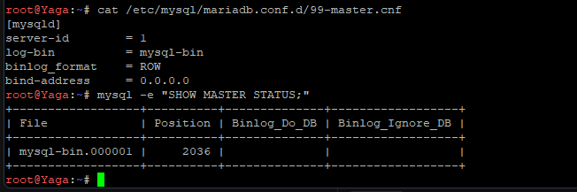

**Status slave**

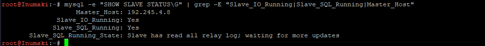

| Field | Nilai |
|---|---|
| `Slave_IO_Running` | Yes |
| `Slave_SQL_Running` | Yes |
| `Master_Host` | 192.245.4.8 |

**Tabel muncul sendiri di slave**

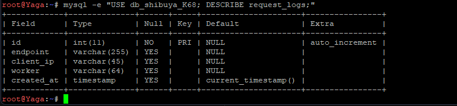

**Insert di master**

```sql
USE db_shibuya_K68;
INSERT INTO request_logs (endpoint, client_ip, worker)
VALUES ('/api/test', '192.245.3.13', 'yaga-manual');
SELECT * FROM request_logs;
```

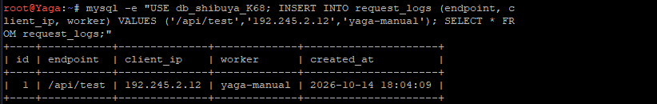

**Baris terbawa ke slave**

```sql
USE db_shibuya_K68;
SELECT * FROM request_logs;
```

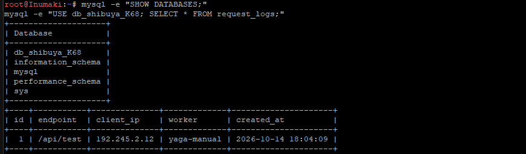

Database, tabel, dan baris data ketiganya muncul di `inumaki` tanpa satu pun dibuat secara manual di sana. Itu membuktikan replikasi berjalan untuk DDL sekaligus DML.

### Catatan

Tabel `request_logs` sengaja dibuat lengkap sejak awal dengan kolom `client_ip` dan `worker`, meskipun soal 13 tidak memintanya. Kedua kolom itu dibutuhkan pada soal lanjutan, yaitu `client_ip` untuk pencatatan IP asli client dan `worker` sebagai bukti pembagian beban. Dengan demikian tidak perlu `ALTER TABLE` di kemudian hari, yang akan merepotkan karena perubahan skema juga harus menunggu replikasi.

Nilai `Slave_IO_Running: Connecting` yang muncul sesaat setelah `START SLAVE` adalah keadaan normal, sebab koneksi ke master masih dibangun. Tunggu beberapa detik lalu periksa kembali, jangan langsung dianggap gangguan.

---

## Struktur Repository

```
.
├── README.md
├── CATATAN-PENGERJAAN.md
├── config/
│   ├── dns.sh                        resolver awal, dipasang di 12 host infrastruktur
│   ├── jichi/
│   │   ├── interfaces                eth0 sampai eth4 beserta baris autostart
│   │   ├── nat.sh                    ip_forward dan MASQUERADE
│   │   └── setup-relay.sh            isc-dhcp-relay
│   ├── tengen/
│   │   └── setup-dhcp.sh             isc-dhcp-server, class, pool, fixed address
│   ├── utahime/
│   │   └── setup-dns.sh              BIND9 master, zona forward dan reverse
│   ├── shoko/
│   │   └── setup-dns.sh              BIND9 slave
│   ├── yaga/
│   │   └── setup-db.sh               MariaDB master, user remote, skema
│   ├── inumaki/
│   │   └── setup-db.sh               MariaDB slave, penyambungan otomatis
│   ├── interfaces/                   berkas interfaces 12 host infrastruktur
│   │   ├── utahime.txt
│   │   ├── shoko.txt
│   │   ├── gojo.txt
│   │   ├── geto.txt
│   │   ├── maki.txt
│   │   ├── panda.txt
│   │   ├── nanami.txt
│   │   ├── todo.txt
│   │   ├── kirara.txt
│   │   ├── yaga.txt
│   │   ├── inumaki.txt
│   │   └── tengen.txt
│   └── clients/
│       └── interfaces-alpinet.txt    dipakai 8 client, isinya dhcp
└── screenshot/
    └── soalNN-deskripsi.png          bukti pengerjaan setiap soal
```

### Urutan Menjalankan dari Keadaan Kosong

Apabila seluruh node baru dinyalakan dan belum ada autostart terpasang, urutannya seperti berikut.

| Urutan | Node | Perintah |
|---|---|---|
| 1 | jichi | `bash /root/nat.sh` |
| 2 | semua host infrastruktur | `bash /root/dns.sh` |
| 3 | tengen | `bash /root/setup-dhcp.sh` |
| 4 | jichi | `bash /root/setup-relay.sh` |
| 5 | utahime | `bash /root/setup-dns.sh` |
| 6 | shoko | `bash /root/setup-dns.sh` |
| 7 | yaga | `bash /root/setup-db.sh` |
| 8 | inumaki | `bash /root/setup-db.sh` |
| 9 | 8 client | `udhcpc -i eth0 -n` |

Dengan autostart yang sudah terpasang pada `jichi`, `tengen`, `utahime`, `shoko`, `yaga`, dan `inumaki`, seluruh langkah 1 sampai 8 berjalan sendiri. Setelah node dinyalakan, cukup tunggu dua sampai tiga menit sampai proses install selesai, lalu client diminta mengambil alamat.
